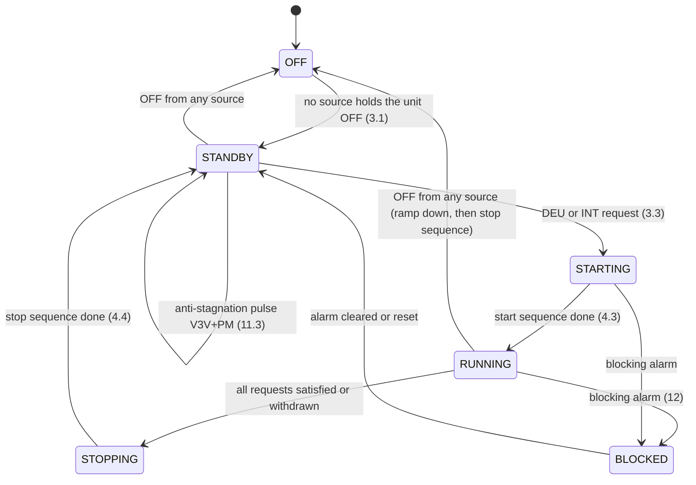

# HRDS+ / Innova DEH+ — how the unit behaves

The **single source of truth on what the unit does**: which operation happens
in which state, for which variant, season and probe configuration, and how
it is commanded from the display, the terminals and Modbus.

Scope rules:

* **Only the unit.** Nothing here describes what the Home Assistant
  integration does on top (guards, entities, defaults it writes). That is in
  [`../adr/`](../adr/README.md) (the decisions) and [`../../README.md`](../../README.md)
  (for users).
* **Registers are named, not defined.** Which registers exist, their
  addresses, encodings, ranges and enum values are only in
  [`MODBUS_REGISTERS.md`](MODBUS_REGISTERS.md). This file refers to them by
  name or parameter code ([PU08](MODBUS_REGISTERS.md#pu08), `sm_UnitStatus` [1104](MODBUS_REGISTERS.md#reg-1104); how to refer to them: [MODBUS_REGISTERS.md](MODBUS_REGISTERS.md)) and says what the unit
  *does* with them.
* **Every statement carries its evidence.** If a statement has no tag, treat it
  as a bug in this file.
* **Parameters are cited by code, not by value.** The behaviour sections say
  [PS01](MODBUS_REGISTERS.md#ps01), never "90 s". What a parameter is, where it is defined, the
  handbook default and the value the reference unit shipped with are in
  [§15](#15-parameters-source-default-and-shipped-value). A shipped value that differs from the handbook
  default is how that unit was configured, not an error in the handbook.

## 0. Evidence tags and sources

| Tag | Meaning |
|-----|---------|
| `[HB 6.3]` | Technical handbook `HRDS+_Technisches_Handbuch_DE.pdf` (text: `.txt`), section number. The end-user handbook (`HRDS+_Benutzerhandbuch_DE.pdf`) is a word-for-word subset of HB §2.4, §5.2, §7 and §9, so it is cited as HB. |
| `[MB p.7]` | Modbus manual `HRDS+_Modbus_RTU_RS485_DE.pdf`, page. |
| `[IM]` | Innova DEH+ H installation manual EN (OEM original). It describes an **older controller** (microswitches, three fixed fan speeds), not the EVCO "K" board of the HRDS+; cited only for the product line. |
| `[V#76]` | Statement by the vendor side (user Murphy08) in the energiesparhaus.at HRDS+ forum thread, post number. |
| `[F#79]` | Field report by another user in the same thread (not verified here). |
| `[T7]` | **Tested**: seen on the reference unit by the repository owner. Each `T` number is an entry in the [evidence log](#13-evidence-log-what-was-seen-on-real-hardware) with date and source. |
| `[INFERRED]` | **Not backed by a source or a test.** Our reading or extrapolation. Open checks are in [`../../plans/todo.md`](../../plans/todo.md). |

When two sources disagree, both are given and the conflict is marked.

### Quick index for agents

| Question | Section |
|----------|---------|
| Which variants exist, how to tell them apart | [1](#1-variants) |
| What is physically inside; terminals and outputs | [2](#2-hardware-air-path-water-path-terminals) |
| Who can switch the unit on/off, change season, raise a request | [3](#3-control-sources-and-precedence) |
| State diagram, start and stop sequences | [4](#4-state-model) |
| The full decision procedure as pseudo-code | [5](#5-decision-procedure-agent-readable) |
| Summer / winter operating modes, water temperature effects | [6](#6-summer-operation), [7](#7-winter-operation) |
| With / without display, with / without probes | [8](#8-display-and-probe-configurations) |
| Fan, compressor, water valves in detail | [9](#9-fan), [10](#10-compressor), [11](#11-water-circuit) |
| Alarms and what they stop | [12](#12-alarms-and-what-they-do-to-the-flow) |
| What was tested on real hardware | [13](#13-evidence-log-what-was-seen-on-real-hardware) |
| How to do X at the display / terminals / Modbus; settings | [14](#14-actions-and-settings-display-terminals-modbus) |
| Parameters: source, handbook default, shipped value | [15](#15-parameters-source-default-and-shipped-value) |

---

## 1. Variants

### 1.1 Product code

`HRDS+ 30 H R K DC` [HB 2.4]:

| Field | Values | Meaning |
|-------|--------|---------|
| `HRDS+` | — | Inverter (variable-speed) compressor [HB 2.4] |
| `30` / `50` | size | Total airflow up to 300 / 500 m³/h [HB 2.4]. Capacity tables: [`doc/references/README.md` → Technical data](README.md#technical-data-airflow-capacity-power). |
| `H` | — | Horizontal (ceiling) installation [HB 2.4] |
| `R` | optional | With recirculation: own fan, motorised damper, air filter [HB 2.1 items 8–10 "nur Umluft-Version", HB 2.4] |
| `K` | — | Controller version K [HB 2.4]; an EVCO controller reporting product code `EPB9…` [T1] |
| `DC` | — | Dehumidification and cooling [HB 2.4] |

The handbook lists four part numbers: 30 and 50, each with and without
recirculation, all `K DC` inverter [HB 2.8]. The Innova line also has a `D`
version ("neutral air dehumidification", isothermal) [IM 2.3]; no `D` HRDS+ is
listed [HB 2.8]. On the K controller, [PG02](MODBUS_REGISTERS.md#pg02) = 0 switches off cooling and
heating ("integration") [HB 6.1.3], which gives the same function set
[INFERRED].

### 1.2 What differs between the variants

| Aspect | `R` (with recirculation) | non-`R` ("ohne Umluft") |
|--------|--------------------------|-------------------------|
| Air connections | Supply duct from the MVHR **plus** a room-air inlet [HB 3.7.1] | Supply duct only [HB 3.7.2] |
| Own fan, damper, filter | Yes [HB 2.1] | No [HB 2.1, 3.7.2] |
| Airflow through the coil | MVHR supply + recirculated room air, up to the nominal 300/500 m³/h total [HB 3.7.1] | Only what the MVHR pushes [HB 3.7.2] |
| During DEU / INT | Damper opens, fan runs — always, see [§9.3](#93-recirculation-is-coupled-to-every-request-r-variant) [HB 2.7, 6.5; V#44, V#76] | Runs on MVHR flow alone [HB 3.7.2] |
| `VMC` contact use | Typically to **lower** the MVHR speed during requests (more recirculation share) [HB 4.5] | Typically to **raise** the MVHR speed during requests [HB 4.5] |
| Weight (30 / 50) | 46 / 57 kg [HB 10] | 43 / 54 kg [HB 10] |

How to tell them apart from the controller: no register states size or `R`
[MB, whole register list; INFERRED that none exists beyond what is listed].

* **`R` vs non-`R`:** the damper output `outDO_RecircDamper` ([1134](MODBUS_REGISTERS.md#reg-1134)). On the reference `R` unit it reads `0` (off) in standby [T5] and on while a
  request runs [T11]. That a non-`R` unit
  reads `2` (disabled, output not allocated) is [INFERRED] from the enum; no
  non-`R` unit has been read.
* **[PG01](MODBUS_REGISTERS.md#pg01) is not the `R` flag.** It selects the fan arrangement ("only supply
  fan" / "supply and exhaust fan") [HB 5.3 PG01]. The reference `R` unit reads
  [PG01](MODBUS_REGISTERS.md#pg01) = 0 [T5].
* **Integration function:** [PG02](MODBUS_REGISTERS.md#pg02) (1 = cooling in summer and heating support
  in winter enabled) [HB 6.1.3]. It is an installer setting, not hardware
  detection [HB 6.1.3].
* **30 vs 50:** not readable [INFERRED]. Type plate only [HB 2.3].
* **Controller:** FC 43 device identification returns vendor `EVCO`, product
  code `EPB9ORSINDEU`, firmware `V01.00.09.02` on the reference unit [T1].
  Whether other sizes/variants report the same product code is open
  [INFERRED; `plans/todo.md`].

### 1.3 Variants seen so far

Only one unit has been read: **HRDS+ 30 `R` `DC`**, no display, no external
probes [T1]. Everything about the HRDS+ 50, non-`R` units, units with a display
or external probes comes from the documents only. The installations the
integration has been used in are in [`doc/tested-setups.md`](../tested-setups.md).

---

## 2. Hardware: air path, water path, terminals

### 2.1 Air path

1. MVHR supply air (and, on `R`, recirculated room air) is mixed and passes
   the **evaporator** of the refrigerant circuit, which cools it below the dew
   point so moisture condenses [HB 2.6].
2. Directly behind it sits the **water register** ("Nachheizregister"), a water
   coil [HB 2.6, 2.6.3].
3. The compressor modulates to hold the evaporator at its setpoint [PU11](MODBUS_REGISTERS.md#pu11),
   independent of the airflow [HB 2.6, 6.3]; seen settling on it [T12].
4. Refrigerant: R410A, hermetically sealed [HB 2.6.3].

### 2.2 Water path

* Water enters the **plate condenser** (refrigerant → water, outside the
  airflow), then an **internal on/off 3-way valve** decides [HB 2.6.1, 2.7]:
  * **open** (series): condenser **and** water register — the condenser heat
    reheats the dried air to about room temperature (DEU), or warm heating
    water heats the air (winter INT), and in standby water can flow through
    both [HB 2.7];
  * **closed**: condenser only — all compressor heat leaves with the water,
    the air stays cold (summer INT) [HB 2.7].
  * It is not proportional: supply air is either well below room temperature
    or near it [HB 2.6.1].
* The **external valve V3V** (2-point, 230 V) and the **pump output PM** are
  switched **together** (relay K5) [HB 4.5].
* The unit has **no heat source** and no electric heater: warming is only
  possible with warm water from the building [HB 2.6.2, 2.7].
* Water flow: 1.5–3.0 l/min (30) / 2.5–4.0 l/min (50) at 16 °C inlet, set
  with the internal valve open; more flow lowers the DEU supply temperature
  [HB 3.8.5].

Hydraulic installations [HB 3.8.6–3.8.8]:

| Variant | Water | Notes |
|---------|-------|-------|
| 1–3: heating/cooling circuit of a heat pump | 16–20 °C in cooling mode [INFERRED typical] | The heat pump must be in cooling mode for summer DEU/INT; the `VMC` contact can request it [HB 3.8.6]. With domestic hot water priority, open the `OFF` input during DHW [HB 3.8.6]. |
| 4–6: brine circuit of a ground-source heat pump (4: in series on the brine inlet side, 5: in series on the outlet side, 6: in a branch parallel to the heat pump) | brine | Independent of the heat pump's mode. **No winter heating possible; active winter dehumidification forbidden (coil freezing); anti-stagnation pulses can blow cold air → switch the unit OFF in winter or drive the brine pump separately** [HB 3.8.7]. |
| separate ground loop | brine | Fully independent; same three winter notes [HB 3.8.8]. |

### 2.3 Terminals (inputs and outputs)

| Terminal | Direction | Behaviour | Source |
|----------|-----------|-----------|--------|
| `OFF`–`OFF` | input | Closed = unit may be ON, open = forced OFF. Priority over the display. Factory: bridged. NO/NC set by [HB03](MODBUS_REGISTERS.md#hb03). | [HB 4.4, 4.5, 6.6] |
| `E/I` | input | Open = summer, closed = winter (NO). Display has priority unless [PC11](MODBUS_REGISTERS.md#pc11) = 1. NO/NC set by [HB04](MODBUS_REGISTERS.md#hb04). | [HB 4.4, 4.5, 6.6] |
| `DEU` | input | Closed forces a dehumidify request; stays active even with a display. NO/NC by [HA06](MODBUS_REGISTERS.md#ha06). | [HB 4.5, 6.6] |
| `INT` | input | Closed forces an integration request (cool in summer, heat in winter). NO/NC by [HA07](MODBUS_REGISTERS.md#ha07). | [HB 4.5, 6.6] |
| `FAN+`/`FAN−` | input 0–10 V | Fan speed request, linear across the active mode's band (0 V = band minimum, 10 V = band maximum); the higher of 0–10 V and display wins; > 10 V disables the signal. | [HB 4.5] |
| `V3V` | output 230 V | External 2-point valve; opens on a request; anti-stagnation pulses. | [HB 4.5, 6.4] |
| `PM` | output 230 V | Pump; **always switched together with V3V**. | [HB 4.5] |
| `VMC` | potential-free | Closed on every DEU or INT request, opens when the request ends. For the MVHR speed or the heat pump's cooling mode. | [HB 2.7, 4.5] |
| `ALL` | potential-free | Closed while at least one alarm is active. | [HB 4.5] |
| `RS+`/`RS−` | Modbus RTU | Address, baud, parity, stop bits only settable at the display or service software; power-cycle after a change. | [MB p.5, p.11] |
| `12 0 C+ D−` | CAN | CNU2 display (A+/B− for the older CNU). | [HB 4.5, 4.6] |

Fixed internal inputs: evaporator probe (AI4), water probe (AI5),
high-pressure switch (DI1), low-pressure switch (DI2) with the frost
thermostat on the same input [HB 6.3; as-delivered allocation T2].

---

## 3. Control sources and precedence

The controller accepts commands from three channels at once: CNU2 display,
terminals and Modbus [HB 2.2, 5.1]. How they combine:

### 3.1 On / off

* Sources: display `ESC` key (only if [PH01](MODBUS_REGISTERS.md#ph01) = 1), `OFF/OFF` contact, Modbus
  `Status_OnOff_byBMS` (only if [PH02](MODBUS_REGISTERS.md#ph02) = 1), time programs ([PH03](MODBUS_REGISTERS.md#ph03)), clock
  [HB 4.5, 5.2.1; MB p.5]. `sm_UnitStatus` names the source that holds it off
  [MB p.9].
* **An OFF from any source beats every ON** [MB p.5].
* [PC12](MODBUS_REGISTERS.md#pc12) = 1: a `DEU` or `INT` **digital input** starts the unit even with the
  `OFF/OFF` contact open [HB 4.5].
* With [PH01](MODBUS_REGISTERS.md#ph01) = 1 and no display the unit stays OFF ("OFF by display")
  [HB 5.1; T2].
* Setting [PH01](MODBUS_REGISTERS.md#ph01) = 0 alone does **not** leave "OFF by display": after
  [PH01](MODBUS_REGISTERS.md#ph01) = 0, [HA00](MODBUS_REGISTERS.md#ha00) = 0, [PH02](MODBUS_REGISTERS.md#ph02) = 1 and a power cycle the unit still read
  `off_by_display`; the first Modbus ON switched it on at once [T7]. A later
  Modbus OFF reads `off_by_bms` [T14]. The Modbus on/off state is kept across
  a power cycle [T30].
* OFF: the unit reacts to no request; Modbus and monitoring stay active
  [HB 2.7].

### 3.2 Season (summer / winter)

* Sources: display (user menu), `E/I` contact, or automatic ([PC05](MODBUS_REGISTERS.md#pc05)) [HB 4.5,
  5.2.4, 5.3 [PC05](MODBUS_REGISTERS.md#pc05)].
* With a display connected, **the display owns the season** unless [PC11](MODBUS_REGISTERS.md#pc11) = 1
  (then the contact does) [HB 4.5, 5.2.4; MB p.6].
* Without a display, Modbus changes the season by rewriting [HB04](MODBUS_REGISTERS.md#hb04): `4` = DI4
  normally open (open contact = summer), `3` = normally closed (open contact =
  winter). Any other value raises **AL25** (I/O configuration error, everything
  off) [MB p.6]. If a contact is wired to `E/I`, writing `3` inverts its
  meaning [INFERRED from MB p.6]. On the reference unit (no contact on DI4)
  writing `3` switched it to winter; the read-back showed the new season at
  the next read cycle, the same lag as the requests (§3.3) [T31]. Writing `4`
  to return to summer is untested [`plans/todo.md`].
* Automatic season: [PC05](MODBUS_REGISTERS.md#pc05) 0 manual / 1 manual + automatic / 2 automatic,
  [PC06](MODBUS_REGISTERS.md#pc06) chooses the water or room probe; with the room probe the unit
  switches to summer above [PC09](MODBUS_REGISTERS.md#pc09) and to winter below [PC10](MODBUS_REGISTERS.md#pc10) [HB 5.3]. How the
  water-probe variant decides is not described [INFERRED: unknown].
* Read back the season in force with `ModeStatus` (1110: summer/winter ×
  manual/auto/DI) and `Mode_OperatingMode` ([1583](MODBUS_REGISTERS.md#reg-1583)) [MB p.6, p.9]. As delivered
  the season followed the `E/I` contact through [HB04](MODBUS_REGISTERS.md#hb04), read as summer
  (`ModeStatus` = "Summer DI"; §15) [T6].

### 3.3 Requests: DEU and INT

The unit has exactly two requests [HB 2.7, 6.1]:

* **DEU** — dehumidify.
* **INT** — "integration": dehumidify + cool in summer, heating support in
  winter [HB 2.6, 2.7, 4.5].

Each request is the **OR** of its sources; any one raises it [HB 6.1]:

| Request | Automatic (display or external room probe) | Digital input | Modbus | Coupling |
|---------|--------------------------------------------|---------------|--------|----------|
| DEU | Room RH > [PU01](MODBUS_REGISTERS.md#pu01) + [PU07](MODBUS_REGISTERS.md#pu07) → on, < [PU01](MODBUS_REGISTERS.md#pu01) → off; held off while room T < [PU13](MODBUS_REGISTERS.md#pu13), back on above [PU13](MODBUS_REGISTERS.md#pu13) + [PU14](MODBUS_REGISTERS.md#pu14) [HB 6.1.1] | `DEU` contact [HB 6.1.1] | `Status_Dehum_byBMS` with [PH28](MODBUS_REGISTERS.md#ph28) = 1 [HB 6.1.1] | Summer INT request + [PU05](MODBUS_REGISTERS.md#pu05) = 1 also raises DEU [HB 6.1.1] |
| INT | Summer: room T > [SEtC](MODBUS_REGISTERS.md#setc) + [PF12](MODBUS_REGISTERS.md#pf12) → on, < [SEtC](MODBUS_REGISTERS.md#setc) − [PF12](MODBUS_REGISTERS.md#pf12) → off. Winter: room T < [SEtH](MODBUS_REGISTERS.md#seth) − [PF12](MODBUS_REGISTERS.md#pf12) → on, > [SEtH](MODBUS_REGISTERS.md#seth) + [PF12](MODBUS_REGISTERS.md#pf12) → off [HB 6.1.2] | `INT` contact [HB 6.1.2] | `Status_Integ_byBMS` with [PH27](MODBUS_REGISTERS.md#ph27) = 1 [HB 6.1.2] | — |

* [PG02](MODBUS_REGISTERS.md#pg02) = 0 disables INT in both seasons [HB 6.1.3].
* The automatic requests cannot be cleared over Modbus; only switching the
  unit off stops them [INFERRED from HB 6.1: no Modbus point disables the
  automatic logic].
* Readability: the **effective** DEU request is `DehumRequest` ([1121](MODBUS_REGISTERS.md#reg-1121)) [MB
  p.9]; the effective INT request is not readable — only the Modbus request
  ([1139](MODBUS_REGISTERS.md#reg-1139)) and the digital input bits (`Packed_logicDI1`) [MB p.6, p.8;
  INFERRED that nothing else exposes it].
* A Modbus request is mirrored back late: on the reference unit an OFF written
  to `Status_OnOff_byBMS` read back as ON for several polls, and the register
  and `sm_UnitStatus` changed together at one later poll [T8]. A dehumidify
  request written to `Status_Dehum_byBMS` showed in `DehumRequest` after more
  than 12 s and within 30 s, three times out of three; clearing it took more
  than 6 s and within 12 s once, within 29 s once; a Modbus OFF showed in
  `sm_UnitStatus` within 26 s [T11, T39].
* Winter automatic heating: [SEtH](MODBUS_REGISTERS.md#seth) is clamped to [PH09](MODBUS_REGISTERS.md#ph09)..[PH10](MODBUS_REGISTERS.md#ph10), which ship
  pinned to the same low value (§15) [HB 5.3]. The handbook says this "prevents"
  automatic heating [HB 5.2.3, 6.1.2]. With [PF12](MODBUS_REGISTERS.md#pf12) as it is, the unit still
  heats whenever the room is below [SEtH](MODBUS_REGISTERS.md#seth) − [PF12](MODBUS_REGISTERS.md#pf12) [INFERRED from HB 6.1.2]. To
  keep it from heating, lower [PH09](MODBUS_REGISTERS.md#ph09) first, then [SEtH](MODBUS_REGISTERS.md#seth) [INFERRED].
* Writes to the "by BMS" registers are ignored while the matching enable
  ([PH02](MODBUS_REGISTERS.md#ph02)/[PH27](MODBUS_REGISTERS.md#ph27)/[PH28](MODBUS_REGISTERS.md#ph28)) is 0 [MB p.5].
* A request written while its enable is 0 is probably kept by the unit and
  starts once the enable is turned on [INFERRED; untested, `plans/todo.md`].

### 3.4 Setpoints

* [SEtC](MODBUS_REGISTERS.md#setc), [SEtH](MODBUS_REGISTERS.md#seth) and [PU01](MODBUS_REGISTERS.md#pu01) are only effective when a display is present or
  external probes are connected [MB p.6].
* [SEtC](MODBUS_REGISTERS.md#setc) is clamped to [PH07](MODBUS_REGISTERS.md#ph07)..[PH08](MODBUS_REGISTERS.md#ph08), [SEtH](MODBUS_REGISTERS.md#seth) to [PH09](MODBUS_REGISTERS.md#ph09)..[PH10](MODBUS_REGISTERS.md#ph10), [PU01](MODBUS_REGISTERS.md#pu01) to
  [PH29](MODBUS_REGISTERS.md#ph29)..[PH30](MODBUS_REGISTERS.md#ph30) [HB 5.3]. The reference unit shipped with limits that pin both temperature
  setpoints and narrow the humidity setpoint (§15); `Actual_Setpoint` read the
  pinned summer value [T2].
* Default [SEtH](MODBUS_REGISTERS.md#seth): 14.0 °C [HB 5.3] vs 20.0 °C [MB p.6] — **sources disagree**.

### 3.5 Fan speed

See [§9](#9-fan). In short: the display (manual) request and 0–10 V feed the
fan; the **highest** wins [HB 4.5, 6.2]. 0–10 V is scaled linearly into the
active mode's min–max band [HB 4.5, 6.2]. The manual request behaves as an
absolute percentage that the band clamps [T22, T24–T26], against the
handbook's "linear skaliert" [HB 6.2]. Modbus has no fan-speed request:
[PM20](MODBUS_REGISTERS.md#pm20) mirrors the manual request, and a value written to it has no effect
[HB 5.3; T23]. Over Modbus only the band acts: raising the minimum above the
running speed raises it, lowering the minimum does not lower it
[T24–T26].

### 3.6 Persistence across a power cycle

* Parameters are kept. The Innova display-panel manual lists "internal memory
  with data storage even in the event of abnormal shutdown or power failure"
  [IM p.28]; that text describes the older panel, not the K board, so for the
  K board it is only supporting evidence.
* On the reference unit [PH01](MODBUS_REGISTERS.md#ph01) = 0 and [PH02](MODBUS_REGISTERS.md#ph02) = 1 survived a power cycle: the
  first Modbus ON took effect immediately afterwards, which an OFF-by-display
  priority ([PH01](MODBUS_REGISTERS.md#ph01) back at 1) or an ignored write ([PH02](MODBUS_REGISTERS.md#ph02) back at 0) would
  have prevented [T7; the reading of T7 is INFERRED]. [PH01](MODBUS_REGISTERS.md#ph01) and [HA00](MODBUS_REGISTERS.md#ha00) read 0
  in every dump and read-back over ten days of operation, so the unit does not
  reset them on its own [T40]. The other parameters were not observed directly
  [INFERRED].
* `Status_OnOff_byBMS` survives a power cycle: the unit came back in the
  on/off state it had [T30]. Whether `Status_Integ_byBMS` and
  `Status_Dehum_byBMS` survive is untested (neither was on at the power cycle)
  [`plans/todo.md`].
* The clock does not survive a long power cut (AL26) [HB 5.2.4].
* Parameters are held in non-volatile memory [IM p.28 wording "internal
  memory"]; a write-cycle limit is not documented anywhere [INFERRED that
  there is one].

---

## 4. State model

### 4.1 States



Sources: HB 2.7 (OFF, ON-standby, DEU, INT), HB 6.2–6.5 (sequences), HB 7.3
(alarms). `RUNNING` has the variants in §4.2.

### 4.2 Outputs per state

`R` variant. A non-`R` unit has no damper and fan; the rest is the same
[HB 2.7, 3.7.2; INFERRED for the controller outputs of a non-`R` unit].

| State | Damper / fan | Compressor | Internal valve | V3V + PM | `VMC` | Supply air | Source |
|-------|--------------|------------|----------------|----------|-------|------------|--------|
| OFF | closed / off | off | open | closed | open | untreated | [HB 2.7] |
| ON-standby | closed / off | off | open | closed, except anti-stagnation pulses | open | untreated; warmed or cooled if water flows through condenser and register without an external valve | [HB 2.7] |
| DEU (summer) | open / on, band [PF28](MODBUS_REGISTERS.md#pf28)..[PF10](MODBUS_REGISTERS.md#pf10) | on | open (heat to register) | open | closed | dry, about room temperature (supply-air temperature not recorded) | [HB 2.6.1, 2.7, 6.2]; damper, fan, compressor, K4 and V3V + PM seen [T11, T12] |
| INT summer, [PU05](MODBUS_REGISTERS.md#pu05) = 1 | open / on, band [PF27](MODBUS_REGISTERS.md#pf27)..[PF09](MODBUS_REGISTERS.md#pf09) | on | **closed** (heat to water) | open | closed | dry and cold | [HB 2.6.1, 2.7, 6.2, 6.4] |
| Summer DEU/INT, water < [PU08](MODBUS_REGISTERS.md#pu08) | open / on | **off** (second step after [PU10](MODBUS_REGISTERS.md#pu10) if [PU09](MODBUS_REGISTERS.md#pu09) = 1) | open | open | closed | cooled and dried by the cold water | [HB 6.3]; internal valve [INFERRED from HB 6.4: only activated with the compressor on] |
| INT winter | open / on | **off** | open | open | closed | warmed only if the water is warm | [HB 2.6.2, 2.7, 4.5, 6.4] |
| BLOCKED (blocking alarm) | closed immediately | off | — | closed immediately | — | untreated | [HB 6.4, 6.5, 7.3] |

### 4.3 Start sequence

1. Request raised (any source) [HB 6.1].
2. External water valve V3V + pump PM open, damper opens, `VMC` closes
   [HB 6.4, 6.5, 4.5; V#76 gives this order].
3. Fan starts after the damper pre-start time [PS01](MODBUS_REGISTERS.md#ps01) (§15) [HB 6.2, 6.5]. Seen:
   the fan came on 32 to 120 s after the damper opened, [PS01](MODBUS_REGISTERS.md#ps01) shipped at 90 s
   [T11].
4. Compressor starts [PE04](MODBUS_REGISTERS.md#pe04) (dehumidify) after the fan and only when the safety
   times allow: min off time [PE01](MODBUS_REGISTERS.md#pe01), min time between starts [PE03](MODBUS_REGISTERS.md#pe03) [HB 6.3]. It first runs at the
   start speed [PE28](MODBUS_REGISTERS.md#pe28) for [PE30](MODBUS_REGISTERS.md#pe30), then modulates [HB 6.3].
5. Commissioning note: at least **7 minutes** from activation to the first
   compressor start [HB 8.2]. Seen: the compressor came on 6.5 to 8 minutes after the request and 5 to 7
   minutes after the fan, so [PE04](MODBUS_REGISTERS.md#pe04) alone is not what held it [T11]; the second
   run gave 6.4 to 7.4 and 5 to 6 minutes [T18]. Over three runs the compressor
   came on 422 to 445 s after the damper was seen open, also when the previous
   compressor stop was only 18 minutes back and the previous start 58 minutes,
   with [PE01](MODBUS_REGISTERS.md#pe01) and [PE03](MODBUS_REGISTERS.md#pe03) long past: the hold counts from the request or the
   fan, not from the last compressor event, and `CmpStatus` reads OFF during
   it [T32]. Which parameter sets it is open [INFERRED; `plans/todo.md`].

The compressor does not start (step 4) while: a blocking alarm is active, a
time program blocks it, room T < [PU13](MODBUS_REGISTERS.md#pu13), or (summer) water < [PU08](MODBUS_REGISTERS.md#pu08) [HB 6.3].

### 4.4 Stop sequence

1. Request ends (all sources clear) [HB 6.3].
2. Compressor stops once its minimum on time [PE02](MODBUS_REGISTERS.md#pe02) has passed; on an OFF or a
   blocking alarm it ramps down via [PE25](MODBUS_REGISTERS.md#pe25) [HB 6.3].
3. V3V + PM stay open for the run-on [Pb01](MODBUS_REGISTERS.md#pb01) (§15), so water keeps flowing while the compressor ramps down [HB 6.4].
4. Fan runs on for [PF03](MODBUS_REGISTERS.md#pf03) at speed [PF26](MODBUS_REGISTERS.md#pf26), keeps its minimum run time [PF01](MODBUS_REGISTERS.md#pf01),
   and **in any case until V3V has closed** [HB 6.2].
5. Damper closes after the request has ended, the compressor is off and V3V
   has closed [HB 6.5].
6. After the valve closes, the anti-stagnation cycle starts counting [HB 6.4].
7. With [PU09](MODBUS_REGISTERS.md#pu09) second step active, the request counts as finished only after
   [PU10](MODBUS_REGISTERS.md#pu10) has passed since the compressor stopped; water keeps flowing
   meanwhile [HB 6.3].

Seen at 1-minute resolution [T19]: compressor in "Wait OFF" within 29 s of the
request ending; compressor off, V3V + PM closed and damper closed in the next
poll (within 61 s); the fan then in "Wait OFF" at 40 % ([PF26](MODBUS_REGISTERS.md#pf26) as shipped) with
the damper already closed, and off one poll later. A second stop ran the same
way, with the fan's run-on between two polls (50 % with the damper closed, off
at the next poll) and the compressor output down to 1 % when the status read
OFF [T36]. A stop by AL03 leaves the output falling for about 3 minutes after
the status reads OFF [T38]. The first anti-stagnation pulse: §11.3.

---

## 5. Decision procedure (agent-readable)

Pseudo-code of what the controller evaluates. Every line cites its source.
Names are parameter codes or register names from
[`MODBUS_REGISTERS.md`](MODBUS_REGISTERS.md).

```text
# ---------- on / off ----------
held_off_by =
    display    if PH01 == 1 and (display says OFF or no display present)   # HB 5.1, MB p.5; T2
    DI         if OFF/OFF contact open (per HB03) and not (PC12 == 1 and DEU/INT DI active)  # HB 4.5
    BMS        if PH02 == 1 and Status_OnOff_byBMS == 0                    # MB p.5
    scheduler  if PH03 == 1 and a time program says OFF                    # HB 5.2.4
    RTC        clock fault / clock rule                                    # MB p.9 (meaning of "OFF by RTC" INFERRED)
unit_on = no source holds it off                                           # MB p.5: OFF beats ON
# stored OFF: after PH01 1->0 and a power cycle the unit stayed "OFF by display" until a Modbus ON  # T7

# ---------- season ----------
if display present and PC11 == 0: season = display setting                 # HB 4.5, 5.2.4
elif PC05 == 2: season = auto (PC06: water or room probe; room: >PC09 summer, <PC10 winter)  # HB 5.3
else: season = E/I contact read through HB04 (4: open = summer, 3: open = winter)  # HB 4.5, MB p.6
# HB04 not in {3, 4} -> AL25                                               # MB p.6

# ---------- requests ----------
room_T, room_RH = from display (HA00) or AI2/AI3 probes (HA02/HA03), else none  # HB 6.7
deu_auto = room_RH available and hysteresis(room_RH, on > PU01+PU07, off < PU01)
           and not held_off(room_T < PU13, release > PU13+PU14)            # HB 6.1.1
           and (season == summer or PU02 != 0)                             # HB 5.3 PU02 (INFERRED that PU02 gates winter DEU this way)
int_auto = room_T available and (
             summer: hysteresis(room_T, on > SEtC+PF12, off < SEtC-PF12)
             winter: hysteresis(room_T, on < SEtH-PF12, off > SEtH+PF12))  # HB 6.1.2
INT = PG02 == 1 and (int_auto or INT_DI or (PH27 == 1 and Status_Integ_byBMS))   # HB 6.1.2, 6.1.3
DEU = deu_auto or DEU_DI or (PH28 == 1 and Status_Dehum_byBMS)
      or (season == summer and INT and PU05 == 1)                          # HB 6.1.1
# DehumRequest (1121) reads DEU; INT itself is not readable                # MB p.9

# ---------- outputs while unit_on and DEU or INT ----------
VMC = closed                                                               # HB 4.5
V3V = PM = open  if season == summer (DEU or INT) or season == winter INT  # HB 6.4
           (winter DEU with PU02 == 1 "with water": INFERRED open; PU02 == 2 "without water": INFERRED closed)
damper = open (R only)                                                     # HB 6.5
fan = on after PS01, band PF28..PF10 (DEU) or PF27..PF09 (INT)             # HB 6.2

compressor_wanted = (summer and INT and PU05 == 1) or DEU_DI or deu_auto
                    or (PH28 == 1 and Status_Dehum_byBMS)                  # HB 6.3
compressor_blocked = blocking alarm or time program or room_T < PU13       # HB 6.3 (no room_T: not vetoed at the shipped PU13, T15)
                     or (summer and water_T < PU08 and not PU09_step_due)  # HB 6.3
                     or (summer and AL03 and not (DEU only and PU03 == 1)) # HB 7.4
                     or safety times PE01/PE03 or fan not yet on for PE04  # HB 6.3
compressor = compressor_wanted and not compressor_blocked
# winter: HB 6.3 lists no winter case; compressor in winter only for DEU with PU02 != 0 (INFERRED)

internal_valve = closed if compressor and INT and season == summer else open   # HB 6.4
# K4 read 1 in standby on the reference unit; MB labels K4 1 = "Dehumidify" (open)  # T5 (standby), T11 (DEU), MB p.8

# ---------- protections, any time ----------
water_T < PA43 for PA42           -> AL16: fan off; clears > PA43 + PA44   # HB 7.4
summer, valve on, water_T > PC07 for PA16 -> AL03                          # HB 7.4
winter INT, valve on, water_T < PC08 for PA16 -> AL04                      # HB 7.4
```

---

## 6. Summer operation

| Request | Condition | What happens | Supply air | Source |
|---------|-----------|--------------|------------|--------|
| none | — | ON-standby (§4.2) | untreated | [HB 2.7] |
| DEU | water ≥ [PU08](MODBUS_REGISTERS.md#pu08) | Compressor; internal valve open | dry, ≈ room T | [HB 2.6.1, 2.7] |
| DEU or INT | water < [PU08](MODBUS_REGISTERS.md#pu08) | **Passive cold-water path**: compressor stays off; cold water in the register cools and dries the air. If the request is still open after [PU10](MODBUS_REGISTERS.md#pu10) and [PU09](MODBUS_REGISTERS.md#pu09) = 1, the compressor joins as a second step; that step ends when the request is satisfied, water keeps flowing | cooled and dried, no compressor | [HB 6.3] |
| INT, [PU05](MODBUS_REGISTERS.md#pu05) = 1 | water ≥ [PU08](MODBUS_REGISTERS.md#pu08) | DEU is raised too; compressor on; internal valve **closed** | dry and cold | [HB 2.7, 6.1.1, 6.3, 6.4] |
| INT, [PU05](MODBUS_REGISTERS.md#pu05) = 0, no DEU | water ≥ [PU08](MODBUS_REGISTERS.md#pu08) | INT does not start the compressor; valve/pump and fan run; cooling by the water only | cooled by water only | [INFERRED from HB 6.1.1, 6.3, 6.4]; untested [`plans/todo.md`] |
| INT + DEU | water ≥ [PU08](MODBUS_REGISTERS.md#pu08) | Compressor on and a cooling request → internal valve **closed** | dry and cold | [HB 6.4]; untested |
| any | water > [PC07](MODBUS_REGISTERS.md#pc07) for [PA16](MODBUS_REGISTERS.md#pa16) while the valve is open | **AL03**: INT blocked, DEU blocked unless [PU03](MODBUS_REGISTERS.md#pu03) = 1; valve "sniffing" [Pb02](MODBUS_REGISTERS.md#pb02)/[Pb03](MODBUS_REGISTERS.md#pb03); clears below [PC07](MODBUS_REGISTERS.md#pc07) − [PA17](MODBUS_REGISTERS.md#pa17) | — | [HB 7.4]; MB p.7 says the compressor stops above [PC07](MODBUS_REGISTERS.md#pc07) and restarts 2 K below |

Notes:

* There is no cooling without dehumidification while the compressor runs:
  the evaporator always condenses [HB 2.6].
* The water source decides the mode: brine early in summer is often below
  [PU08](MODBUS_REGISTERS.md#pu08) → passive path; a heat pump in cooling mode delivers about 16–20 °C →
  compressor [INFERRED from HB 3.8.6, 6.3]; a heating-only circuit is too warm
  to take the heat → AL03 [INFERRED from HB 7.4].
* Neither the passive path nor [PU05](MODBUS_REGISTERS.md#pu05) = 0 has been seen on the reference unit
  [`plans/todo.md`].

## 7. Winter operation

| Request | Condition | What happens | Source |
|---------|-----------|--------------|--------|
| none | — | ON-standby; anti-stagnation pulses can blow cold air on brine | [HB 2.7, 3.8.7]; the pulses are seen hourly in ON-standby [T13] |
| INT ([PG02](MODBUS_REGISTERS.md#pg02) = 1) | water ≥ [PC08](MODBUS_REGISTERS.md#pc08) | **Heating support**: compressor off, both valves open, V3V+PM open, fan runs; warms only with warm water | [HB 2.6.2, 2.7, 4.5, 6.4] |
| INT | water < [PC08](MODBUS_REGISTERS.md#pc08) for [PA16](MODBUS_REGISTERS.md#pa16) | **AL04**: heating blocked, valve sniffing; clears above [PC08](MODBUS_REGISTERS.md#pc08) + [PA17](MODBUS_REGISTERS.md#pa17). MB: heating starts only above [PC08](MODBUS_REGISTERS.md#pc08) + 2 K | [HB 7.4; MB p.7] |
| INT automatic | room T < [SEtH](MODBUS_REGISTERS.md#seth) − [PF12](MODBUS_REGISTERS.md#pf12) | The unit heats by itself whenever a room temperature is available (§3.3) | [HB 6.1.2] |
| DEU | [PU02](MODBUS_REGISTERS.md#pu02) = 0 | No winter dehumidification | [HB 5.3 PU02; INFERRED that this also blocks DI/Modbus DEU] |
| DEU | [PU02](MODBUS_REGISTERS.md#pu02) = 1 "with water" / `2` "without water" | Winter dehumidification enabled. What "with/without water" changes (V3V/PM open or not) is not described | [HB 5.3; INFERRED: unknown] |
| any, brine circuit | — | Heating impossible; active winter DEU forbidden (coil freezing); switch the unit OFF in winter | [HB 3.8.7, 3.8.8] |

* [PC08](MODBUS_REGISTERS.md#pc08): the reference unit ships with a lower value than the handbook and
  the Modbus manual give (§15).
* Heating has not been seen on the reference unit [`plans/todo.md`].

## 8. Display and probe configurations

| Configuration | Required settings | Room T/H | Automatic DEU/INT | Setpoints act | Season owner | Source |
|---------------|-------------------|----------|-------------------|---------------|--------------|--------|
| CNU2 display (T+H) | [PH01](MODBUS_REGISTERS.md#ph01) = 1, [HA00](MODBUS_REGISTERS.md#ha00) = 6 | display's own sensors | yes | yes | display ([PC11](MODBUS_REGISTERS.md#pc11) = 0) or `E/I` ([PC11](MODBUS_REGISTERS.md#pc11) = 1) | [HB 5.1, 6.7, 8.1] |
| CNU2 display T only + external humidity | [HA00](MODBUS_REGISTERS.md#ha00) = 5, [HA03](MODBUS_REGISTERS.md#ha03) = 53/54 | display T, AI3 humidity | yes | yes | as above | [HB 6.7] |
| No display, external probes | [PH01](MODBUS_REGISTERS.md#ph01) = 0, [HA00](MODBUS_REGISTERS.md#ha00) = 0, [HA02](MODBUS_REGISTERS.md#ha02) = 45, [HA03](MODBUS_REGISTERS.md#ha03) = 53/54 | AI2 NTC 10 kΩ B3435, AI3 0–10 V or 4–20 mA | yes | yes | `E/I` or [HB04](MODBUS_REGISTERS.md#hb04) over Modbus | [HB 6.7; MB p.6]; untested |
| **Headless** (no display, no probes) | [PH01](MODBUS_REGISTERS.md#ph01) = 0, [HA00](MODBUS_REGISTERS.md#ha00) = 0, [HA02](MODBUS_REGISTERS.md#ha02) = [HA03](MODBUS_REGISTERS.md#ha03) = 0 | none | **no** — only `DEU`/`INT` inputs and Modbus requests | **no** | `E/I` or [HB04](MODBUS_REGISTERS.md#hb04) | [HB 5.1, 8.1; MB p.6]; reference unit [T2, T3, T7] |
| Display configured, none fitted | [PH01](MODBUS_REGISTERS.md#ph01) = 1 | — | — | — | — | Unit stays "OFF by display" [HB 5.1; T2] |

Observations and consequences:

* Unwired analog inputs read a sentinel word (`0x8004`), not 0; the factory
  water and evaporator probes read real values [T3]. Details:
  [`MODBUS_REGISTERS.md` §14.4](MODBUS_REGISTERS.md#144-unwired-analog-inputs-read-a-sentinel-not-a-temperature).
* Probe alarms AL28 (room T) / AL34 (room RH) are meant to fire when a
  configured source is missing [HB 7.3]. On the headless reference unit,
  "OFF by display", none were set [T4], and none appeared once the
  unit was ON and dehumidifying [T15].
* [PU13](MODBUS_REGISTERS.md#pu13) with no room temperature: the interlock did not veto a Modbus dehumidify request on the
  reference unit at its shipped [PU13](MODBUS_REGISTERS.md#pu13) [T15]. Whether it vetoes at the
  handbook default, or a DI request, is untested [`plans/todo.md`]. Values: §15.
* The outdoor probe (`AI_Toutdoor`) only drives free cooling/heating, and
  only when [PG03](MODBUS_REGISTERS.md#pg03) = 1 [HB 5.3 PG03]. Free cooling acts through a "Bypass
  Free-Cooling/Free-Heating" relay output, one of the allocatable outputs
  [HB 5.3]; [INFERRED] that a standard HRDS+ has no such bypass wired. The reference unit ships with [PG03](MODBUS_REGISTERS.md#pg03) on and no outdoor probe (§15).
* Exhaust and discharge probes are display-only [INFERRED from HB 6, which
  uses neither]. Without them the unit has no reading of the air it supplies:
  on the reference unit [502](MODBUS_REGISTERS.md#reg-502) and [503](MODBUS_REGISTERS.md#reg-503) read the sentinel while dehumidifying, so
  the reheat to about room temperature (§2.2) is not seen from the unit [T18].
* Old CNU display ([HA00](MODBUS_REGISTERS.md#ha00) = 1/2): the reference unit shipped with the old-CNU value without any display (§15).

## 9. Fan

### 9.1 Bands and sources

* Active band: DEU [PF28](MODBUS_REGISTERS.md#pf28)..[PF10](MODBUS_REGISTERS.md#pf10), INT [PF27](MODBUS_REGISTERS.md#pf27)..[PF09](MODBUS_REGISTERS.md#pf09); defaults and shipped values in §15 [HB 6.2; MB p.7].
* Sources: display manual request (fan screen, step [PF11](MODBUS_REGISTERS.md#pf11)) and 0–10 V
  potentiometer. The highest request wins [HB 4.5, 6.2].
  * **0–10 V:** a position scaled linearly into the band, 0 V = minimum,
    10 V = maximum [HB 4.5, 6.2]. Not tested.
  * **Manual (display) request:** the handbook says it is scaled linearly
    into the band too [HB 6.2]. On the headless reference unit it behaves as
    an **absolute percentage clamped into the band**: it starts at 0, is
    clamped up to [PF28](MODBUS_REGISTERS.md#pf28) when the fan starts [T16, T22], follows a raised
    [PF28](MODBUS_REGISTERS.md#pf28) [T25] and keeps its value when [PF28](MODBUS_REGISTERS.md#pf28) is lowered [T24, T26]. A
    rescaled position would have followed a lowered minimum down. [INFERRED]
    that "linear skaliert" for the display means "stepped by [PF11](MODBUS_REGISTERS.md#pf11) between
    minimum and maximum". **The sources disagree**; no display was tested.
  * So with nothing else requesting, the fan does not stop on request 0: it
    runs at the band minimum [T16, T18].
* The Modbus map has one read-only register per request: integration
  `FanIntegration_Request` ([1112](MODBUS_REGISTERS.md#reg-1112)), air quality ([1113](MODBUS_REGISTERS.md#reg-1113)), manual / display
  ([1114](MODBUS_REGISTERS.md#reg-1114)), time bands ([1115](MODBUS_REGISTERS.md#reg-1115)), potentiometer ([1116](MODBUS_REGISTERS.md#reg-1116)), each 0–100 % [MB p.14–15].
  [INFERRED] that the output is the highest of them within the band, as
  HB 6.2 says for manual and potentiometer. The time-band request follows the
  setpoints [FSC](MODBUS_REGISTERS.md#fsc)/[FSE](MODBUS_REGISTERS.md#fse)/[FSN](MODBUS_REGISTERS.md#fsn) ([1595](MODBUS_REGISTERS.md#reg-1595)–[1597](MODBUS_REGISTERS.md#reg-1597)) only with time programs on ([PH03](MODBUS_REGISTERS.md#ph03))
  [MB p.18; INFERRED from HB 5.2.4]; [PF23](MODBUS_REGISTERS.md#pf23) ([1660](MODBUS_REGISTERS.md#reg-1660)) is the speed forced by a
  digital input [MB p.20].
* **No register takes a fan-speed request from the BMS.** The "by BMS"
  registers are on/off, DEU, INT and holiday only [MB p.5, p.14–15]. [PM20](MODBUS_REGISTERS.md#pm20)
  ([1614](MODBUS_REGISTERS.md#reg-1614)) is listed R/W in the raw parameter table [MB p.18], but the
  handbook defines it as "Einstellung der Zuluftventilator-Geschwindigkeit
  via Display (read only)" [HB 5.3], and the Modbus fan chapter lists only
  the bands and the read-only requests [MB p.7]. The unit sets [PM20](MODBUS_REGISTERS.md#pm20) itself
  [T22]. A value written to it inside the band is acknowledged and read back
  as the unit's own value [T23], even at reads 0.5 s apart [T28]; one below
  the band minimum is refused with exception 04 [T27]. [INFERRED] the unit
  checks a write against the active band's limits and then keeps its own
  request. Whether a display unit takes a Modbus write is not known.
* What Modbus can change is the band: "Dieser Arbeitsbereich des Lüfters kann
  in den Geräte-Einstellungen oder per Modbus individuell … konfiguriert
  werden" [HB 4.5]. Seen on the reference unit during a DEU run:
  * [PF28](MODBUS_REGISTERS.md#pf28) 50 → 45: output and [PM20](MODBUS_REGISTERS.md#pm20) stayed at 50 % [T24].
  * [PF28](MODBUS_REGISTERS.md#pf28) 45 → 55: output and [PM20](MODBUS_REGISTERS.md#pm20) read 55 % in the same poll (≤ 60 s)
    [T25].
  * [PF28](MODBUS_REGISTERS.md#pf28) 55 → 50: output and [PM20](MODBUS_REGISTERS.md#pm20) stayed at 55 % [T26].

  So a raised minimum pushes a running fan up; a lowered one leaves it where
  it is. [INFERRED] from the clamp: lowering the maximum ([PF10](MODBUS_REGISTERS.md#pf10), [PF09](MODBUS_REGISTERS.md#pf09))
  below the running speed pulls it down, and restoring the band afterwards
  keeps the new speed until the request ends (as T26 does for the minimum).
  Open: whether the change jumps or ramps in [PF11](MODBUS_REGISTERS.md#pf11) steps (the polls were
  60 s apart), whether [PF27](MODBUS_REGISTERS.md#pf27) acts the same during INT, and whether the next
  run starts at a changed [PF28](MODBUS_REGISTERS.md#pf28)
  ([`plans/fan-speed-tests.md`](../../plans/fan-speed-tests.md)).
  [PF28](MODBUS_REGISTERS.md#pf28)/[PF10](MODBUS_REGISTERS.md#pf10)/[PF27](MODBUS_REGISTERS.md#pf27)/[PF09](MODBUS_REGISTERS.md#pf09) are EEPROM parameters (§3.6).
* Display manual control works while no time programs are enabled ([PH03](MODBUS_REGISTERS.md#ph03))
  and a DEU request, or an INT request with [PF31](MODBUS_REGISTERS.md#pf31) ≠ 0, is active [HB 6.2]. [PF31](MODBUS_REGISTERS.md#pf31) = 0: INT fan follows the
  room temperature ([PF12](MODBUS_REGISTERS.md#pf12), [PF13](MODBUS_REGISTERS.md#pf13)) [HB 5.3 PF31].
* One user could not get the fan below 30 % [F#77].
* [PF07](MODBUS_REGISTERS.md#pf07)..[PF08](MODBUS_REGISTERS.md#pf08) ("VMC" band) bounds the post-run speed [PF26](MODBUS_REGISTERS.md#pf26) [HB 5.3 PF26]. The
  HRDS+ has no ventilation-only mode with its fan [HB 2.7]; [INFERRED] that
  [PF07](MODBUS_REGISTERS.md#pf07)/[PF08](MODBUS_REGISTERS.md#pf08) matter only for run-on.
* Read-backs: `outAO_SupplyFan` (actual output), `actRPMsupplyFan`,
  `SupplyFan_ManualRequest` (display's request), `SupplyFan_RemoteRequest`
  (potentiometer) [MB p.7, p.8, p.15]. On the reference unit `outAO_SupplyFan`
  followed the fan (50 % while it ran) [T16]. Only `outAO_SupplyFan` is the
  speed the fan gets: the fan screen, and so [PM20](MODBUS_REGISTERS.md#pm20)/[1114](MODBUS_REGISTERS.md#reg-1114), is not changed by
  the potentiometer request [HB 6.2]. Whether [1116](MODBUS_REGISTERS.md#reg-1116) holds the raw 0–10 V
  percentage or the value scaled into the band is open [INFERRED].
* `actRPMsupplyFan` needs a tachometer signal on an input: input function 45
  ("AI: Return/room temp. / DI: Tachometer signal supply fan") or 46 (return
  fan) [HB 5.3, input functions]. No input of the reference unit is allocated
  to either [T21], and [1117](MODBUS_REGISTERS.md#reg-1117) read 0 with the fan running [T16, T18]: the 0 is
  the unit's value, not a wrong read. The speed-sensor alarm ([PA23](MODBUS_REGISTERS.md#pa23)..[PA25](MODBUS_REGISTERS.md#pa25))
  can then not act either [INFERRED].
* The unit writes the manual request itself: [PM20](MODBUS_REGISTERS.md#pm20) and the display request
  went from 0 to [PF28](MODBUS_REGISTERS.md#pf28) (50 %) in the poll in which the fan started and back
  to 0 when the request ended, with no write from the BMS [T16, T22], and
  followed a raised [PF28](MODBUS_REGISTERS.md#pf28) [T25]. A value written to [PM20](MODBUS_REGISTERS.md#pm20) had no effect
  [T23] and never showed in a read [T28].

### 9.2 Timing

* Starts [PS01](MODBUS_REGISTERS.md#ps01) after the damper opens [HB 6.2].
* Minimum run time [PF01](MODBUS_REGISTERS.md#pf01), run-on [PF03](MODBUS_REGISTERS.md#pf03) at [PF26](MODBUS_REGISTERS.md#pf26), and always until V3V is
  closed [HB 6.2].
* AL16 (water antifreeze) stops the fan [HB 7.3].
* States Disabled / OFF / Wait ON / ON / Wait OFF (run-on) / Alarm
  (overheating or speed sensing) [HB 6.2].
* The fan turns in ON and in Wait OFF, the run-on at [PF26](MODBUS_REGISTERS.md#pf26) (40 % seen,
  [T19]). The handbook has Wait ON as the wait before the start [HB 6.2]. On
  the reference unit `SupplyFan_Status` read OFF and `outAO_SupplyFan` 0 at
  every poll between the damper opening and the fan starting, up to 61 s after
  the damper was seen open, and never read Wait ON [T35]. A shorter Wait ON
  between polls is not excluded [`plans/todo.md`].
* Nothing over Modbus switches the fan by itself: it starts and stops with
  the DEU / INT requests (§9.3), and [PM20](MODBUS_REGISTERS.md#pm20) does not hold a speed [T23, T27,
  T28] [INFERRED from the register map: no other fan command exists].

### 9.3 Recirculation is coupled to every request (`R` variant)

* Every DEU and INT request opens the damper and runs the fan; only OFF /
  ON-standby has the damper closed [HB 2.7, 6.5]. Seen for DEU on the
  reference unit [T11]; INT is untested.
* "Ohne Umluft" is the hardware variant, not an operating mode [HB 2.1, 2.8,
  3.7.2].
* Vendor: "whenever the compressor runs, recirculation is active" [V#44];
  dehumidification is strictly coupled to recirculation; start order water
  valve, damper and VMC, then fan after a delay, then compressor [V#76];
  setting the fan to 0 does not help, the damper opens anyway [V#78].
* No register selects "dehumidify without recirculation" [MB].
* No single register reports "recirculating": recirculation is the damper
  output ([1134](MODBUS_REGISTERS.md#reg-1134)) on with the fan running. `FanIntegration_Request` ([1112](MODBUS_REGISTERS.md#reg-1112))
  stayed 0 throughout two recirculating dehumidify runs [T16, T18].
* When the fan started, the MVHR's constant-flow supply dropped from 163 to
  115 m³/h for about a minute and then recovered [T18]: the running
  recirculation fan changes the pressure in the MVHR supply duct.
* Field reports (unofficial, not tried here) [F#77–#79, #93]:
  * Disabling the fan output (AO4) or the damper output (DO1) stops the
    compressor from starting.
  * Fan output moved to the spare AO3 ([HC03](MODBUS_REGISTERS.md#hc03) = 1, [HC04](MODBUS_REGISTERS.md#hc04) = 0) plus damper
    relay inverted ([HD01](MODBUS_REGISTERS.md#hd01) 10 → 9, NO → NC): an HRDS+ 50 ran on MVHR supply air
    alone at 368 m³/h with about 1.7 l/h of condensate. The inverted damper is
    then **open in standby** [INFERRED from the NO/NC meaning].
  * After moving the fan output, the controller reports a fan that is not
    turning (`outAO_SupplyFan`, `SupplyFan_Status`) [INFERRED].
* With the damper open and the fan slow or stopped, the recirculation inlet is
  connected to the supply chamber; if the inlet is teed into the MVHR extract
  duct, supply air short-circuits into the extract [INFERRED from HB 3.7.1
  airflow layout]. A backdraft valve in that branch prevents it [INFERRED].
* AL11 (low pressure / frost thermostat) remains the compressor's guard
  against too little airflow [HB 6.3, 7.4].

### 9.4 Non-`R` variant

No own fan; airflow comes from the MVHR only [HB 3.7.2]. The `VMC` contact
can raise the MVHR speed during requests [HB 4.5]. That this proves the
refrigerant circuit works on MVHR flow alone follows from the design
[HB 3.7.2]; what a non-`R` controller reports for fan and damper is
[INFERRED], no unit read.

## 10. Compressor

* Turns on for: summer INT with [PU05](MODBUS_REGISTERS.md#pu05) = 1, `DEU` input, room RH >
  [PU01](MODBUS_REGISTERS.md#pu01) + [PU07](MODBUS_REGISTERS.md#pu07), Modbus DEU with [PH28](MODBUS_REGISTERS.md#ph28) = 1 [HB 6.3].
* Turns off when all hold: INT satisfied (with [PU05](MODBUS_REGISTERS.md#pu05) = 1), `DEU` input
  inactive, room RH < [PU01](MODBUS_REGISTERS.md#pu01), Modbus DEU cleared [HB 6.3].
* Does not start with: a blocking alarm, a blocking time program, room T <
  [PU13](MODBUS_REGISTERS.md#pu13), summer water < [PU08](MODBUS_REGISTERS.md#pu08) [HB 6.3].
* Modulation: incremental neutral-zone control on the evaporator temperature:
  above [PU11](MODBUS_REGISTERS.md#pu11) + [PU12](MODBUS_REGISTERS.md#pu12) step up by [PE08](MODBUS_REGISTERS.md#pe08) every [PE09](MODBUS_REGISTERS.md#pe09), below [PU11](MODBUS_REGISTERS.md#pu11) − [PU12](MODBUS_REGISTERS.md#pu12) step
  down [HB 6.3]. Output limits: DEU [PE06](MODBUS_REGISTERS.md#pe06)..[PE07](MODBUS_REGISTERS.md#pe07), INT [PE21](MODBUS_REGISTERS.md#pe21)..[PE22](MODBUS_REGISTERS.md#pe22) [HB 6.3].
* Inverter: start speed [PE28](MODBUS_REGISTERS.md#pe28) for [PE30](MODBUS_REGISTERS.md#pe30); hold at [PE29](MODBUS_REGISTERS.md#pe29) for [PE31](MODBUS_REGISTERS.md#pe31); below
  [PE28](MODBUS_REGISTERS.md#pe28) for longer than [PE32](MODBUS_REGISTERS.md#pe32) → off; ramps [PE24](MODBUS_REGISTERS.md#pe24)/[PE25](MODBUS_REGISTERS.md#pe25)/[PE26](MODBUS_REGISTERS.md#pe26) (enabled by
  [PE33](MODBUS_REGISTERS.md#pe33)) [HB 6.3].
* Safety times [PE01](MODBUS_REGISTERS.md#pe01) min off, [PE02](MODBUS_REGISTERS.md#pe02) min on, [PE03](MODBUS_REGISTERS.md#pe03) min between starts,
  [PE04](MODBUS_REGISTERS.md#pe04) fan-to-compressor delay [HB 6.3].
* No active defrost; a frost thermostat on the low-pressure input stops the
  compressor via AL11 [HB 6.3].
* Status values Disabled / Alarm / Manual / OFF / Wait ON / Wait OFF / ON
  [HB 6.3]. Read back `CmpStatus` and `outAO_Cmp` [MB p.8, p.9].
* Wait ON is the minimum off time: with the request still on, the status reads
  Wait ON for about 5 minutes ([PE01](MODBUS_REGISTERS.md#pe01)) after a compressor stop, then ON. Starts
  came less than [PE03](MODBUS_REGISTERS.md#pe03) after a stop, so [PE03](MODBUS_REGISTERS.md#pe03) is not counted from the stop;
  the shortest start-to-start was 361 to 480 s [T33].
* It stops by itself during a long request: 92, 94 and 93 minutes after each
  start, with no alarm, at 24 to 31 % output, and restarts about 6 minutes
  later; the evaporator rises to about 15 °C in between [T34]. That fits
  [PE32](MODBUS_REGISTERS.md#pe32) (below [PE28](MODBUS_REGISTERS.md#pe28) for too long → off [HB 6.3]) if its value counts
  minutes, not the seconds the parameter table gives [INFERRED;
  `plans/todo.md`].
* Seen on the reference unit [T12]: output 15.7 %, then 32.8 %, then 44.0 %
  (about the [PE28](MODBUS_REGISTERS.md#pe28) step against [PE27](MODBUS_REGISTERS.md#pe27)); the evaporator fell from 18 °C to
  −3.1 °C in two polls; the output then stepped down about 6 % per minute
  (the handbook's [PE08](MODBUS_REGISTERS.md#pe08)/[PE09](MODBUS_REGISTERS.md#pe09) defaults are 1 % every 10 s) and the evaporator
  settled on [PU11](MODBUS_REGISTERS.md#pu11) a few minutes later at about 25 % output. AL11 stayed
  clear. The MVHR supplied about 100 m³/h on its lowest preset throughout.
  In the second run, with the MVHR at 140 to 163 m³/h, the same start dipped
  further, to −9.6 °C, and settled on [PU11](MODBUS_REGISTERS.md#pu11) at 27 % within 6 minutes [T18]: the
  dip is the start transient, not too little airflow.

## 11. Water circuit

### 11.1 Internal valve (relay K4)

* Compressor off → deactivated; compressor for dehumidification only →
  deactivated; compressor on **and** a cooling request → activated [HB 6.4].
* In hydraulic terms: "open" (water through condenser and register) in
  OFF/standby, DEU and winter INT; "closed" (condenser only) in summer INT
  [HB 2.7].
* **Read-back conflict.** The reference unit read `outDO_WaterCond` ([1124](MODBUS_REGISTERS.md#reg-1124)) =
  1 (ON) and `Packed_DO1` bits 12–13 = 1 in standby [T5], where HB 6.4 says
  "deactivated". The Modbus manual annotates those `Packed_DO1` bits
  "0 = Integration, 1 = Dehumidify" [MB p.8]. Reading: `1` means the
  dehumidify/open position, which is also the standby position [INFERRED].
  It read 1 as well while dehumidifying with the compressor on [T11], as
  expected for the open position. Not yet read while cooling [`plans/todo.md`].

### 11.2 External valve V3V and pump PM (relay K5)

* Open (one output) on a summer DEU/INT request and a winter INT request
  [HB 6.4, 4.5]. Not opened in standby except the anti-stagnation pulses
  [HB 2.7]. Seen opening with a summer DEU request [T11] and as the periodic
  pulses [T13].
* Run-on [Pb01](MODBUS_REGISTERS.md#pb01) after the request ends [HB 6.4].
* A pump wired to `PM` starts with a request and the [1126](MODBUS_REGISTERS.md#reg-1126) read-back follows
  [T10].
* Closed immediately on a blocking alarm [HB 6.4].
* Not configured (output disabled) means the unit cannot drive a pump
  [MB p.15 "Disable"; INFERRED consequence]. The reference unit ships with [HD05](MODBUS_REGISTERS.md#hd05) allocating the water valve (§15).

### 11.3 Anti-stagnation and sniffing

* General anti-stagnation: always enabled; after the valve closes, wait [Pb08](MODBUS_REGISTERS.md#pb08) (minutes, as the handbook's parameter table gives it) then open
  for [Pb07](MODBUS_REGISTERS.md#pb07) (seconds); also one cycle of [Pb07](MODBUS_REGISTERS.md#pb07) when the unit is switched on
  [HB 6.4]. Seen with the shipped [Pb07](MODBUS_REGISTERS.md#pb07)/[Pb08](MODBUS_REGISTERS.md#pb08): valve and pump open for about a
  minute, stay shut for the [Pb08](MODBUS_REGISTERS.md#pb08) wait counted from the valve closing, and
  repeat, while the unit is ON-standby; the switch-on pulse is a little longer
  [T13]. After a request the first pulse came about 2 hours after the valve
  closed, then hourly again [T20]; after a stop by AL03 and one sniffing pulse
  it came about 1 hour after that pulse [T37]. Why the first differs is open
  [`plans/todo.md`].
* While the unit is OFF there is no pulse: none in 8.5 hours of `off_by_bms`,
  while the same unit pulsed hourly when ON [T14], and none in the seven days
  of `off_by_bms` after that [T37]. That agrees with HB 2.7
  (lists it under ON) and HB 3.8.7 (recommends OFF to avoid cold bursts on
  brine), not with the wording "independent of operation" in HB 4.5.
* Sniffing on AL03 (summer) / AL04 (winter): wait [Pb03](MODBUS_REGISTERS.md#pb03), open [Pb02](MODBUS_REGISTERS.md#pb02), repeat
  until the alarm clears during an open phase [HB 6.4].

### 11.4 Water temperature thresholds (summary)

| Threshold | Effect | Source |
|-----------|--------|--------|
| [PA43](MODBUS_REGISTERS.md#pa43) for [PA42](MODBUS_REGISTERS.md#pa42), clear at [PA43](MODBUS_REGISTERS.md#pa43) + [PA44](MODBUS_REGISTERS.md#pa44) | AL16, fan off | [HB 7.4] |
| [PU08](MODBUS_REGISTERS.md#pu08), summer | Below: no compressor (passive path) | [HB 6.3] |
| [PC08](MODBUS_REGISTERS.md#pc08), winter | Below for [PA16](MODBUS_REGISTERS.md#pa16): AL04, heating blocked | [HB 7.4] |
| [PC07](MODBUS_REGISTERS.md#pc07), summer | Above for [PA16](MODBUS_REGISTERS.md#pa16): AL03, INT (and DEU unless [PU03](MODBUS_REGISTERS.md#pu03)) blocked | [HB 7.4] |

The water probe reads the water at the unit. With V3V + PM closed that is the
brine standing in the pipe, which warms up while nothing flows; once V3V + PM
open it falls to the circuit's temperature within about two minutes (T17;
18.7 °C standing in T3). A comparison against [PU08](MODBUS_REGISTERS.md#pu08), [PC07](MODBUS_REGISTERS.md#pc07), [PC08](MODBUS_REGISTERS.md#pc08) or [PA43](MODBUS_REGISTERS.md#pa43)
right at a request start therefore sees the standing value first. Whether the
unit decides on that first reading is open [`plans/todo.md`]. With no flow the
probe also follows the air through the unit (it rose 16.6 → 18.1 °C with the
evaporator probe when warmer MVHR air arrived), and it did not rise when the
compressor started [T18]: it reads the water before the condenser, so it
cannot show the condenser heat [INFERRED from T18].

When the water flow fails with the compressor running, the probe does show the
heat: on the reference unit, with its small pump in a branch parallel to the
heat pump, the brine fell short while the stronger heat pump pump ran. The
water read 17.3 → 45.9 °C within 3 minutes, the compressor stopped and restarted
on its timers, AL12 raised for one poll, and AL03 ended the request [PA16](MODBUS_REGISTERS.md#pa16) after
the water stayed above [PC07](MODBUS_REGISTERS.md#pc07) [T38]. AL03 cleared within 29 s of the Modbus
request ending, with the water at 34.3 °C, above the [PC07](MODBUS_REGISTERS.md#pc07) − [PA17](MODBUS_REGISTERS.md#pa17) of [HB 7.4]
[T38].

## 12. Alarms and what they do to the flow

Codes, bit positions and reset registers:
[`MODBUS_REGISTERS.md` §9](MODBUS_REGISTERS.md#9-alarms). Behaviour [HB 7.3,
7.4]:

| Alarm | Trigger | Effect on the flow | Reset |
|-------|---------|--------------------|-------|
| AL02 | Room RH > [PA19](MODBUS_REGISTERS.md#pa19), or `DEU` input longer than [PA58](MODBUS_REGISTERS.md#pa58), for longer than [PA21](MODBUS_REGISTERS.md#pa21) | [PA57](MODBUS_REGISTERS.md#pa57) = 0: display only. [PA57](MODBUS_REGISTERS.md#pa57) = 1: unit stops | Power cycle; display-only also when the DEU demand is satisfied; blocking after [PA60](MODBUS_REGISTERS.md#pa60) |
| AL03 | Summer, valve active with a request, water > [PC07](MODBUS_REGISTERS.md#pc07) for [PA16](MODBUS_REGISTERS.md#pa16) | INT blocked, DEU blocked unless [PU03](MODBUS_REGISTERS.md#pu03) = 1, sniffing | Water < [PC07](MODBUS_REGISTERS.md#pc07) − [PA17](MODBUS_REGISTERS.md#pa17) |
| AL04 | Winter INT, valve active, water < [PC08](MODBUS_REGISTERS.md#pc08) for [PA16](MODBUS_REGISTERS.md#pa16) | Heating blocked, sniffing | Water > [PC08](MODBUS_REGISTERS.md#pc08) + [PA17](MODBUS_REGISTERS.md#pa17) |
| AL11 | Low-pressure switch or frost thermostat for [PA31](MODBUS_REGISTERS.md#pa31) (bypassed [PA30](MODBUS_REGISTERS.md#pa30) after a start); also if active when a start is requested | Compressor stops / does not start | Auto; manual after [PA32](MODBUS_REGISTERS.md#pa32) events per hour |
| AL12 | High-pressure switch | Compressor stops at once | Auto; manual after [PA35](MODBUS_REGISTERS.md#pa35) per hour |
| AL16 | Water < [PA43](MODBUS_REGISTERS.md#pa43) for [PA42](MODBUS_REGISTERS.md#pa42) | Fan stops | Water > [PA43](MODBUS_REGISTERS.md#pa43) + [PA44](MODBUS_REGISTERS.md#pa44) |
| AL18 | Generic alarm | Everything off | Manual |
| AL22 | Fan hours reach the limit | Display only | Manual (alarm menu, or fan hours to 0) |
| AL25 | I/O configuration error (e.g. [HB04](MODBUS_REGISTERS.md#hb04) not 3/4) | Everything off | Auto [MB p.6] |
| AL26 | Clock lost (long power cut) | Time programs disabled | Auto |
| AL28 / AL29 / AL30 / AL34 / AL36 / AL39 | Room T / outdoor / water / room RH / fan potentiometer / evaporator probe fault | "Disables the controls that depend on it" | Auto |

* A blocking alarm closes the damper and the external valve at once [HB 6.4,
  6.5].
* Alarms are visible while the unit is OFF [HB 7.3].
* No alarm bits were set on the reference unit as delivered [T4], nor during
  the first dehumidify run, including AL11 at the −3.1 °C evaporator reading
  [T12, T15], nor at −9.6 °C in the second [T18].

---

## 13. Evidence log: what was seen on real hardware

Reference unit: **HRDS+ 30 `R` `DC`**, headless (no display, no external
probes). "Dump" means
[`tests/devices/hrds_30+_headless_factory_state.json`](../../tests/devices/hrds_30+_headless_factory_state.json)
(read-only diagnostic, taken before the integration wrote anything).

| # | Date | What | Source |
|---|------|------|--------|
| T1 | 2026-10 | FC 43/14 identity (basic, regular, extended): `EVCO` / `EPB9ORSINDEU` / `V01.00.09.02`; all four status registers hold documented enum values | dump |
| T2 | 2026-10 | As-delivered settings: see [§15](#15-parameters-source-default-and-shipped-value). Unit status `off_by_display` (with [PH01](MODBUS_REGISTERS.md#ph01) = 1, no display) | dump |
| T3 | 2026-10 | Unwired analog inputs [499](MODBUS_REGISTERS.md#reg-499), [500](MODBUS_REGISTERS.md#reg-500), [502](MODBUS_REGISTERS.md#reg-502)–[506](MODBUS_REGISTERS.md#reg-506), 508–510, [512](MODBUS_REGISTERS.md#reg-512) read `0x8004`; [507](MODBUS_REGISTERS.md#reg-507) reads `0x7FFA`; water ([501](MODBUS_REGISTERS.md#reg-501)) 18.7 °C and evaporator ([511](MODBUS_REGISTERS.md#reg-511)) 16.8 °C read real values; inputs 513–519 read 0 (unidentified) | dump |
| T4 | 2026-10 | No alarm bits set ([768](MODBUS_REGISTERS.md#reg-768)/[769](MODBUS_REGISTERS.md#reg-769)/[770](MODBUS_REGISTERS.md#reg-770) = 0, `OR_Alarms` = 0) while OFF by display with no probes | dump |
| T5 | 2026-10 | `R` unit: [PG01](MODBUS_REGISTERS.md#pg01) = 0; damper output [1134](MODBUS_REGISTERS.md#reg-1134) = 0 (off); fan status OFF; compressor status OFF; [1112](MODBUS_REGISTERS.md#reg-1112) = 0; K5 ([1126](MODBUS_REGISTERS.md#reg-1126)) = 0; **K4 ([1124](MODBUS_REGISTERS.md#reg-1124)) = 1** and `Packed_DO1` bits 12–13 = 1 in standby | dump |
| T6 | 2026-10 | Season: [HB04](MODBUS_REGISTERS.md#hb04) = 4, `ModeStatus` = Summer DI, `Mode_OperatingMode` = summer, [PC05](MODBUS_REGISTERS.md#pc05) = 0 | dump |
| T7 | 2026-10-20 | [PH01](MODBUS_REGISTERS.md#ph01) = 0, [HA00](MODBUS_REGISTERS.md#ha00) = 0, [PH02](MODBUS_REGISTERS.md#ph02) = 1 and a power cycle: still `off_by_display`. First Modbus ON → `on` at once (so [PH01](MODBUS_REGISTERS.md#ph01) and [PH02](MODBUS_REGISTERS.md#ph02) kept their values, §3.6) | [`plans/todo.md`](../../plans/todo.md), PR #31 |
| T8 | 2026-10-21 | OFF written to `Status_OnOff_byBMS`: register read ON for several polls; register and `sm_UnitStatus` changed together at one later poll | PR #32 |
| T9 | 2026-10-20 | Through the RS-485→TCP gateway a 120-register read got no reply at all; 10-register reads covered the whole map | PR #28 |
| T10 | 2026-10-22 | A pump on the `PM` output ran when the unit started a request; the water valve/pump read-back ([1126](MODBUS_REGISTERS.md#reg-1126)) followed. Run-on [Pb01](MODBUS_REGISTERS.md#pb01) and the OFF edge not logged | owner |
| T11 | 2026-10-22 | First Modbus dehumidify (DEU) request, written 07:03:53. `DehumRequest`, damper ([1134](MODBUS_REGISTERS.md#reg-1134)) and V3V + PM ([1126](MODBUS_REGISTERS.md#reg-1126)) on within 28 s; fan on 32 to 120 s after the damper; compressor on 6.5 to 8 min after the request and 5 to 7 min after the fan; fan output 50 %, `SupplyFan_Status` on, K4 ([1124](MODBUS_REGISTERS.md#reg-1124)) = 1 | [run file](../../tests/devices/runs/hrds_30+_first_dehumidify_run_2026-10-22.json) |
| T12 | 2026-10-22 | Compressor and evaporator in that run: output 15.7, 32.8, 44.0 %, evaporator 18.2, 5.6, −3.1 °C in three polls; then output stepping down about 6 % per minute and the evaporator back on 6.1 °C at 25 % a few minutes later; MVHR about 100 m³/h | [run file](../../tests/devices/runs/hrds_30+_first_dehumidify_run_2026-10-22.json) |
| T13 | 2026-10-21/22 | Anti-stagnation: V3V + PM open about 1 min, shut 60 min (counted from closing), repeat: 22 periodic pulses from 09:33 to 06:56 while ON-standby; one longer pulse (92 s, 96 s) at each Modbus ON | HA history |
| T14 | 2026-10-21 | Modbus OFF at 00:03 read `off_by_bms`; no V3V + PM pulse in the 8.5 h until the next Modbus ON at 08:31 | HA history |
| T15 | 2026-10-22 | In the dehumidify run, with no room probe: the compressor started ([PU13](MODBUS_REGISTERS.md#pu13) as shipped did not veto), no alarm bit set (AL11, AL28, AL34, AL03, AL04, AL16 clear, alarm flag off) | [run file](../../tests/devices/runs/hrds_30+_first_dehumidify_run_2026-10-22.json) |
| T16 | 2026-10-22 | The fan was running (confirmed by the owner) while `actRPMsupplyFan` ([1117](MODBUS_REGISTERS.md#reg-1117)) read 0 before and during; `outAO_SupplyFan` 50 %; `FanIntegration_Request` ([1112](MODBUS_REGISTERS.md#reg-1112)) stayed 0 with fan and damper on; [PM20](MODBUS_REGISTERS.md#pm20) ([1614](MODBUS_REGISTERS.md#reg-1614)) and the display request ([1114](MODBUS_REGISTERS.md#reg-1114)) went 0 to 50 % in the poll in which the fan started | [run file](../../tests/devices/runs/hrds_30+_first_dehumidify_run_2026-10-22.json) |
| T17 | 2026-10-22 | Water probe: 21.9 °C standing at 06:50; 19.8 then 17.4 °C right after the 06:57 pulse, creeping back up to 18.3 °C by the request; 14.8 °C two polls after V3V + PM opened, 14.3 to 15.3 °C while flowing. The owner confirms the brine stands in the pipe and warms up | [run file](../../tests/devices/runs/hrds_30+_first_dehumidify_run_2026-10-22.json) |
| T18 | 2026-10-23 | Second DEU run, MVHR at 140 to 163 m³/h: fan on 29 to 89 s after the request, compressor 6.4 to 7.4 min after it; evaporator 6.2, −9.6, −6.7, 1.2, 4.7, 6.5 °C, then 6.3 to 6.7 °C at 27 %, no alarm; [1117](MODBUS_REGISTERS.md#reg-1117) = 0, [1112](MODBUS_REGISTERS.md#reg-1112) = 0, K4 ([1124](MODBUS_REGISTERS.md#reg-1124)) = 1, [502](MODBUS_REGISTERS.md#reg-502)/[503](MODBUS_REGISTERS.md#reg-503) unknown; water probe 16.6 → 18.1 °C with no flow as warmer MVHR air arrived, 17.9 → 16.4 °C after the compressor started; MVHR supply flow 163 → 115 m³/h in the minute the fan started, back to 141 and 157 m³/h | [run file](../../tests/devices/runs/hrds_30+_dehumidify_run_2026-10-23.json) |
| T19 | 2026-10-22 | DEU stop, request cleared 07:36:57: `CmpStatus` Wait OFF at 07:37:26; at 07:37:58 compressor off, V3V + PM ([1126](MODBUS_REGISTERS.md#reg-1126)) off, damper ([1134](MODBUS_REGISTERS.md#reg-1134)) off, fan Wait OFF at 40 %; fan off at 07:38:53 | [run file](../../tests/devices/runs/hrds_30+_dehumidify_run_2026-10-23.json) |
| T20 | 2026-10-22 | After that stop (valve closed by 07:37:58) the first anti-stagnation pulse came at 09:39:57, then 10:40:53, 11:41:54 (hourly), unit ON throughout | HA history |
| T21 | 2026-10 | No input allocated to the fan tachometer (functions 45/46): [HA01](MODBUS_REGISTERS.md#ha01) = 58, [HA02](MODBUS_REGISTERS.md#ha02) = [HA03](MODBUS_REGISTERS.md#ha03) = 0, [HA04](MODBUS_REGISTERS.md#ha04) = 52, [HA05](MODBUS_REGISTERS.md#ha05) = 47, [HA06](MODBUS_REGISTERS.md#ha06) = 6, [HA07](MODBUS_REGISTERS.md#ha07) = 8, [HA08](MODBUS_REGISTERS.md#ha08)..[HA18](MODBUS_REGISTERS.md#ha18) = 0, [HB01](MODBUS_REGISTERS.md#hb01) = 27, [HB02](MODBUS_REGISTERS.md#hb02) = 26, [HB03](MODBUS_REGISTERS.md#hb03) = 2, [HB04](MODBUS_REGISTERS.md#hb04) = 4, [HB05](MODBUS_REGISTERS.md#hb05)..[HB07](MODBUS_REGISTERS.md#hb07) = 0. Read again on the running unit on 2026-10-23 (fan on at 50 %): the same allocations, [1117](MODBUS_REGISTERS.md#reg-1117) = 0 | dump; `diagnose_hrds.py` 2026-10-23 |
| T22 | 2026-10-22/23 | [PM20](MODBUS_REGISTERS.md#pm20) ([1614](MODBUS_REGISTERS.md#reg-1614)) and the display request ([1114](MODBUS_REGISTERS.md#reg-1114)) 0 → 50 % when the fan started (both runs) and 50 → 0 % at the stop (07:37:58), with no write from Home Assistant to [1614](MODBUS_REGISTERS.md#reg-1614). Again on 2026-10-23: 0 at the end of a request (11:29:56), 50 at the next fan start (11:43:12) | [run file](../../tests/devices/runs/hrds_30+_dehumidify_run_2026-10-23.json), [band run file](../../tests/devices/runs/hrds_30+_fan_band_2026-10-23.json) |
| T23 | 2026-10-23 | Fan speeds inside the band ([PF28](MODBUS_REGISTERS.md#pf28)..[PF10](MODBUS_REGISTERS.md#pf10) = 50–85 %: 60, 55 %) written to [PM20](MODBUS_REGISTERS.md#pm20) ([1614](MODBUS_REGISTERS.md#reg-1614)) during the DEU run from 11:43, before the band changes of T24–T26: the unit acknowledged the writes; none had any effect, the read-back stayed at 50 % (= [PF28](MODBUS_REGISTERS.md#pf28)) | owner; Home Assistant log |
| T24 | 2026-10-23 | DEU run from 11:43:12 (compressor on 11:49:15), fan at 50 %. [PF28](MODBUS_REGISTERS.md#pf28) 50 → 45 at 11:58:37: `outAO_SupplyFan` ([639](MODBUS_REGISTERS.md#reg-639)) and [PM20](MODBUS_REGISTERS.md#pm20) stayed at 50 %. ([PF27](MODBUS_REGISTERS.md#pf27) 50 → 45 → 50 at 11:58:22 / 11:58:53 does not apply to DEU) | [band run file](../../tests/devices/runs/hrds_30+_fan_band_2026-10-23.json) |
| T25 | 2026-10-23 | Same run, [PF28](MODBUS_REGISTERS.md#pf28) 45 → 55 at 12:57:03: [639](MODBUS_REGISTERS.md#reg-639) and [PM20](MODBUS_REGISTERS.md#pm20) read 55 % in the same poll | [band run file](../../tests/devices/runs/hrds_30+_fan_band_2026-10-23.json) |
| T26 | 2026-10-23 | Same run, later, [PF28](MODBUS_REGISTERS.md#pf28) 55 → 50: [639](MODBUS_REGISTERS.md#reg-639) and [PM20](MODBUS_REGISTERS.md#pm20) stayed at 55 % | owner; [band run file](../../tests/devices/runs/hrds_30+_fan_band_2026-10-23.json) |
| T27 | 2026-10-23 | [PM20](MODBUS_REGISTERS.md#pm20) writes below the band minimum ([PF28](MODBUS_REGISTERS.md#pf28) = 50 %) during DEU runs were refused with Modbus exception 04 (FC 06 → 0x86): 40 % eleven times 11:28:38–11:29:05 (run from 10:44), 45 % at 11:52:15 (run from 11:43) | Home Assistant log |
| T28 | 2026-10-23 | During the run from 11:43, `diagnose_hrds.py --watch` reading [1614](MODBUS_REGISTERS.md#reg-1614), [1114](MODBUS_REGISTERS.md#reg-1114) and [639](MODBUS_REGISTERS.md#reg-639) every 0.5 s while 60, 55, 50 and 45 % were written to [PM20](MODBUS_REGISTERS.md#pm20): no change of [1614](MODBUS_REGISTERS.md#reg-1614), [1114](MODBUS_REGISTERS.md#reg-1114) or [639](MODBUS_REGISTERS.md#reg-639) was seen (50 needed no write, 45 was refused, T27) | owner, watch output |
| T29 | 2026-10-23 | Hour counters count whole hours: [PM01](MODBUS_REGISTERS.md#pm01) ([1604](MODBUS_REGISTERS.md#reg-1604)) 0 → 1 and [PM04](MODBUS_REGISTERS.md#pm04) ([1610](MODBUS_REGISTERS.md#reg-1610)) 0 → 1 at 11:59 after about 1.6 h of fan and 1.1 h of compressor run time since the factory dump (Home Assistant history of [1119](MODBUS_REGISTERS.md#reg-1119) / [1122](MODBUS_REGISTERS.md#reg-1122)). At ×0.1 h they would read about 16 and 11. Again at 20:21: [PM01](MODBUS_REGISTERS.md#pm01) = 7 and [PM04](MODBUS_REGISTERS.md#pm04) = 6 after about 7.1 h of fan and 6.1 h of compressor (nothing ran after 17:27). The odd neighbours [1603](MODBUS_REGISTERS.md#reg-1603), [1605](MODBUS_REGISTERS.md#reg-1605), [1609](MODBUS_REGISTERS.md#reg-1609), [1611](MODBUS_REGISTERS.md#reg-1611) read 0 in both dumps, so the counters are single 16-bit words. [PM00](MODBUS_REGISTERS.md#pm00)/[PM03](MODBUS_REGISTERS.md#pm03) read 20000, the handbook's "2000.0, Hours x10", so the display shows raw ÷ 10 in units of 10 h | dumps (factory, 2026-10-23 11:59 and 20:21); HA history |
| T30 | 2026-10 | Power cycle: the unit came back in the on/off state written to `Status_OnOff_byBMS` ([1105](MODBUS_REGISTERS.md#reg-1105)). No DEU or INT request was on at the time | owner |
| T31 | 2026-10-30 | [HB04](MODBUS_REGISTERS.md#hb04) ([1825](MODBUS_REGISTERS.md#reg-1825)) written 4 → 3: the read-back still showed summer right after the write and showed winter at the next read cycle (20:48:59), a lag as for the other registers (T8, T11). No contact on DI4. 3 → 4 not written | owner; HA history |
| T32 | 2026-10-22/23 | Compressor hold in three runs, polls (t1, t2]: request written → compressor on 417–479, 414–475, 450–511 s; damper read → on 389–451, 384–445, 422–483 s; fan on → on 297–419, 295–416, 302–422 s. The third start came 18.3–19.3 min after the previous compressor stop and 58–59 min after the previous start. `CmpStatus` read OFF until ON at each | [history review](../../tests/devices/runs/hrds_30+_history_review_2026-10-30.json) |
| T33 | 2026-10-23 | `CmpStatus` Wait ON six times within one request: seen 13:22:13, 15:02:16, 16:41:13, 17:04:14, 17:12:16, 17:19:13; ON at 13:27:13, 15:07:12, 16:46:15, 17:09:12, 17:16:12, 17:24:12, about 300 s after each stop. Shortest start-to-start 361–480 s (17:09:12 → 17:16:12) | [history review](../../tests/devices/runs/hrds_30+_history_review_2026-10-30.json) |
| T34 | 2026-10-23 | Compressor stops with the request on and no alarm: ON 11:49:15, Wait OFF 13:21:17 at 30.5 %; ON 13:27:13, Wait OFF 15:01:14 at 24.1 %; ON 15:07:12, Wait OFF 16:40:11 at 29.2 %. Evaporator 6 → 15 °C while off. [PE32](MODBUS_REGISTERS.md#pe32) ([1887](MODBUS_REGISTERS.md#reg-1887)) reads 90 | [history review](../../tests/devices/runs/hrds_30+_history_review_2026-10-30.json); dump |
| T35 | 2026-10-22/23 | Three fan starts: `SupplyFan_Status` OFF and [639](MODBUS_REGISTERS.md#reg-639) = 0 at the polls 32 s (07:04:53), 29 s (10:43:17) and 61 s (11:42:13) after the damper read on; ON and 50 % together at the next poll. Wait ON was never read | [history review](../../tests/devices/runs/hrds_30+_history_review_2026-10-30.json) |
| T36 | 2026-10-23 | DEU stop, request cleared 11:29:09: `CmpStatus` Wait OFF at 11:29:21 (26.5 %); at 11:29:56 compressor off (1.0 %), V3V + PM off, damper off, fan on at 50 %; fan off and 0 % at 11:30:57 | [history review](../../tests/devices/runs/hrds_30+_history_review_2026-10-30.json) |
| T37 | 2026-10-23/30 | After the AL03 stop the valve opened 17:29:12–17:30:47 (180 s after closing, [Pb03](MODBUS_REGISTERS.md#pb03)), then at 18:30:15, 19:31:17, 20:32:15, 21:34:18, 22:35:15. Modbus OFF read at 22:39:41 on 2026-10-23: no pulse up to at least 2026-10-30 22:29 | [history review](../../tests/devices/runs/hrds_30+_history_review_2026-10-30.json); HA history |
| T38 | 2026-10-23 | Brine flow lost during a DEU run while the heat pump compressor ran (17:01:35–17:27:29): the heat pump's pump overpowers the unit's small `PM` pump (owner). Water 17.3 °C at 17:01:15, 31.0 at 17:02:12, 45.9 at 17:04:14, 27.1 at 17:09:12, then above 30 °C from (17:10:13, 17:11:12]. AL12 and `CmpStatus` Alarm at 17:11:12, clear at 17:12:16. AL03 at (17:25:12, 17:26:12]: `DehumRequest` off with the Modbus request on; compressor status off, V3V + PM off, damper off, fan Wait OFF at 40 %, fan off 17:27:12; output 45.2 % falling to 0 by 17:29:12. Modbus request cleared 17:30:18; AL03 clear at 17:30:47 with water 34.3 °C | [history review](../../tests/devices/runs/hrds_30+_history_review_2026-10-30.json); owner |
| T39 | 2026-10-22/23 | Write to first read-back, with re-reads at 3, 6, 12 and 25 s: `Status_Dehum_byBMS` on → `DehumRequest` 28, 30, 28 s (not yet at the 12 s re-read); off → 29 s and 12 s (not yet at 6 s); `Status_OnOff_byBMS` off → `sm_UnitStatus` 26 s | [history review](../../tests/devices/runs/hrds_30+_history_review_2026-10-30.json) |
| T40 | 2026-10-20/30 | [PH01](MODBUS_REGISTERS.md#ph01) ([1777](MODBUS_REGISTERS.md#reg-1777)) and [HA00](MODBUS_REGISTERS.md#ha00) ([1803](MODBUS_REGISTERS.md#reg-1803)) read 0 in the dumps of 2026-10-20 23:53 and 2026-10-23 11:59 and 20:21 and in the read-back up to 2026-10-30, with no change recorded | dumps; [history review](../../tests/devices/runs/hrds_30+_history_review_2026-10-30.json) |
| T41 | 2026-10-23 | Dumps against the factory dump. During DEU at 11:59: [384](MODBUS_REGISTERS.md#reg-384), [639](MODBUS_REGISTERS.md#reg-639), [641](MODBUS_REGISTERS.md#reg-641), [1114](MODBUS_REGISTERS.md#reg-1114), [1119](MODBUS_REGISTERS.md#reg-1119), [1121](MODBUS_REGISTERS.md#reg-1121), [1122](MODBUS_REGISTERS.md#reg-1122), [1126](MODBUS_REGISTERS.md#reg-1126), [1134](MODBUS_REGISTERS.md#reg-1134), [1140](MODBUS_REGISTERS.md#reg-1140), [1614](MODBUS_REGISTERS.md#reg-1614) at their running values, all back at 20:21; [1112](MODBUS_REGISTERS.md#reg-1112) = 0, [1124](MODBUS_REGISTERS.md#reg-1124) = 1, [1117](MODBUS_REGISTERS.md#reg-1117) = 0, no alarm bit. Setup: [1777](MODBUS_REGISTERS.md#reg-1777), [1778](MODBUS_REGISTERS.md#reg-1778), [1799](MODBUS_REGISTERS.md#reg-1799), [1803](MODBUS_REGISTERS.md#reg-1803). On: [1104](MODBUS_REGISTERS.md#reg-1104), [1105](MODBUS_REGISTERS.md#reg-1105). Counters [1604](MODBUS_REGISTERS.md#reg-1604), [1610](MODBUS_REGISTERS.md#reg-1610). Not in the register doc: [1101](MODBUS_REGISTERS.md#reg-1101) and [1102](MODBUS_REGISTERS.md#reg-1102), which change in every dump | dumps; [history review](../../tests/devices/runs/hrds_30+_history_review_2026-10-30.json) |

Not yet observed on hardware (everything else in this file): the stop sequence
of a DEU cycle at better than 1-minute resolution, an INT cycle, the passive cold-water path, winter operation,
a lowered band maximum ([PF10](MODBUS_REGISTERS.md#pf10)) during a run, any display or probe
configuration, the HRDS+ 50 and non-`R` units. The test
plans are in [`plans/todo.md`](../../plans/todo.md). When a test is done, add a
`T` row here and replace the `[INFERRED]` tag where it applies.

Third-party field reports (energiesparhaus.at HRDS+ thread):

| # | Who | What |
|---|-----|------|
| V#44 | vendor side, 2025-12-04 | "Immer wenn der Kompressor läuft, ist auch der Umluftbetrieb aktiv." |
| V#76 | vendor side, 2026-05-08 | Dehumidification strictly coupled to recirculation; start order water valve, damper and VMC output, fan after a delay, then compressor |
| V#78 | vendor side, 2026-05-08 | Fan 0 "bringt ja nichts, weil die Klappe dann trotzdem aufgeht"; unsure whether [HD01](MODBUS_REGISTERS.md#hd01) = 0 works without a restart |
| F#77–#79 | user manuon, 2026-05 | Fan not below 30 %; AO4 or DO1 disabled → no compressor start; [HD01](MODBUS_REGISTERS.md#hd01) NO → NC inverts the damper |
| F#93 | user manuon, 2026-05 | AO3 fan reassignment + [HD01](MODBUS_REGISTERS.md#hd01) NC on an HRDS+ 50: MVHR supply only, 368 m³/h, about 1.7 l/h condensate |

---

## 14. Actions and settings: display, terminals, Modbus

How each operation is done through each channel. Register addresses and the
write recipes are in
[`MODBUS_REGISTERS.md` §11](MODBUS_REGISTERS.md#11-cookbook--common-operations).

| Action | CNU2 display | Terminals | Modbus | Unit behaviour / notes |
|--------|--------------|-----------|--------|------------------------|
| Switch on / off | Hold `ESC` 2 s (needs [PH01](MODBUS_REGISTERS.md#ph01) = 1) [HB 5.2.1] | `OFF/OFF` contact [HB 4.5] | `Status_OnOff_byBMS`, needs [PH02](MODBUS_REGISTERS.md#ph02) = 1 [MB p.5] | OFF from any source wins (§3.1) |
| Change season | User menu [HB 5.2.4]; only there while a display is connected and [PC11](MODBUS_REGISTERS.md#pc11) = 0 | `E/I` contact [HB 4.5] | Rewrite [HB04](MODBUS_REGISTERS.md#hb04) 4/3 [MB p.6] | §3.2; AL25 on other values |
| Dehumidify | Automatic from RH vs target [HB 5.2.3] | `DEU` contact [HB 4.5] | `Status_Dehum_byBMS`, needs [PH28](MODBUS_REGISTERS.md#ph28) = 1 | §3.3, §6, §7 |
| Cool (summer) / heat (winter) | Automatic from T vs target [HB 5.2.3] | `INT` contact [HB 4.5] | `Status_Integ_byBMS`, needs [PH27](MODBUS_REGISTERS.md#ph27) = 1 and [PG02](MODBUS_REGISTERS.md#pg02) = 1 | §3.3, §6, §7 |
| Target humidity | Humidity screen, OK, ↑/↓ [HB 5.2.3] | — | [PU01](MODBUS_REGISTERS.md#pu01) | Clamped [PH29](MODBUS_REGISTERS.md#ph29)..[PH30](MODBUS_REGISTERS.md#ph30); only effective with display or probe [MB p.6] |
| Target temperature | Temperature screen [HB 5.2.3] | — | [SEtC](MODBUS_REGISTERS.md#setc) / [SEtH](MODBUS_REGISTERS.md#seth) | Clamped [PH07](MODBUS_REGISTERS.md#ph07)..[PH08](MODBUS_REGISTERS.md#ph08) / [PH09](MODBUS_REGISTERS.md#ph09)..[PH10](MODBUS_REGISTERS.md#ph10) (§3.4) |
| Fan speed | Fan screen, hold ↑/↓ 2 s while the fan runs [HB 5.2.3] | `FAN` 0–10 V [HB 4.5] | No request register; only the band [PF27](MODBUS_REGISTERS.md#pf27)/[PF28](MODBUS_REGISTERS.md#pf28)–[PF09](MODBUS_REGISTERS.md#pf09)/[PF10](MODBUS_REGISTERS.md#pf10) [HB 4.5; MB p.7]: a raised minimum raises a running fan, a lowered one does not lower it [T24–T26]. [PM20](MODBUS_REGISTERS.md#pm20) mirrors the manual request; writing it has no effect, outside the band it is refused [T23, T27, T28] | Highest request wins; 0–10 V scaled into the band, the manual request clamped into it (§9.1) |
| Reset an alarm | Alarm menu, hold OK 3 s [HB 5.2.4] | — | Reset registers (AL11/AL12/AL18) [MB p.10] | Only when the cause is gone [HB 5.2.4] |
| Reset filter alarm AL22 | Alarm menu or counters menu (fan hours → 0) [HB 7.4] | — | Write 0 to [PM01](MODBUS_REGISTERS.md#pm01) [MB p.9] | The registers count whole hours; the display shows them ÷ 10 as "Hours x10" [T29; HB 5.3] |
| Time programs | Time program menu; disabled as delivered [HB 5.2.4] | — | [PH03](MODBUS_REGISTERS.md#ph03) | Can hold the unit OFF and block the compressor (§3.1, §10) |
| Clock | `CLOCK` line [HB 5.2.4] | — | — | Lost after a long power cut → AL26 [HB 5.2.4] |
| Modbus address / baud / parity / stop bits | Installer menu → MODBUS (installer password) [MB p.11] | — | Listed R/W, but only configurable at the display or service software [MB p.5] | Power-cycle after a change [MB p.11] |
| Other parameters | Service, maintenance, installer, manufacturer menus (password levels; manufacturer only while OFF) [HB 5.2.4] | — | Most are holding registers ([`MODBUS_REGISTERS.md` §16](MODBUS_REGISTERS.md#16-installer-menu-parameters-installer-device)) | Changes can void the warranty [HB 5.2.4] |

### 14.1 Settings that decide the flow

What each setting does is in the sections above; this table is the lookup.

| Setting | Decides | Section |
|---------|---------|---------|
| [PH01](MODBUS_REGISTERS.md#ph01), [PH02](MODBUS_REGISTERS.md#ph02), [PH27](MODBUS_REGISTERS.md#ph27), [PH28](MODBUS_REGISTERS.md#ph28), [PC12](MODBUS_REGISTERS.md#pc12), [HB03](MODBUS_REGISTERS.md#hb03), [PH03](MODBUS_REGISTERS.md#ph03) | Who may switch on/off and raise requests | §3.1, §3.3 |
| [HA00](MODBUS_REGISTERS.md#ha00), [HA02](MODBUS_REGISTERS.md#ha02), [HA03](MODBUS_REGISTERS.md#ha03) | Room T/H source → automatic requests | §8 |
| [PC05](MODBUS_REGISTERS.md#pc05), [PC06](MODBUS_REGISTERS.md#pc06), [PC09](MODBUS_REGISTERS.md#pc09), [PC10](MODBUS_REGISTERS.md#pc10), [PC11](MODBUS_REGISTERS.md#pc11), [HB04](MODBUS_REGISTERS.md#hb04) | Season | §3.2 |
| [PG02](MODBUS_REGISTERS.md#pg02) | Integration (cool/heat) at all | §3.3 |
| [PG03](MODBUS_REGISTERS.md#pg03) | Free cooling/heating on the outdoor probe | §8 |
| [PU01](MODBUS_REGISTERS.md#pu01), [PU07](MODBUS_REGISTERS.md#pu07), [PU13](MODBUS_REGISTERS.md#pu13), [PU14](MODBUS_REGISTERS.md#pu14), [SEtC](MODBUS_REGISTERS.md#setc), [SEtH](MODBUS_REGISTERS.md#seth), [PF12](MODBUS_REGISTERS.md#pf12), [PH07](MODBUS_REGISTERS.md#ph07)–[PH10](MODBUS_REGISTERS.md#ph10), [PH29](MODBUS_REGISTERS.md#ph29), [PH30](MODBUS_REGISTERS.md#ph30) | Automatic request thresholds and clamps | §3.3, §3.4 |
| [PU02](MODBUS_REGISTERS.md#pu02), [PU03](MODBUS_REGISTERS.md#pu03), [PU05](MODBUS_REGISTERS.md#pu05), [PU08](MODBUS_REGISTERS.md#pu08), [PU09](MODBUS_REGISTERS.md#pu09), [PU10](MODBUS_REGISTERS.md#pu10) | Winter DEU, DEU under AL03, INT→DEU coupling, passive path | §6, §7 |
| [PC07](MODBUS_REGISTERS.md#pc07), [PC08](MODBUS_REGISTERS.md#pc08), [PA16](MODBUS_REGISTERS.md#pa16), [PA17](MODBUS_REGISTERS.md#pa17), [PA42](MODBUS_REGISTERS.md#pa42)–[PA44](MODBUS_REGISTERS.md#pa44) | Water temperature limits and alarms | §11.4, §12 |
| [PF27](MODBUS_REGISTERS.md#pf27), [PF28](MODBUS_REGISTERS.md#pf28), [PF09](MODBUS_REGISTERS.md#pf09), [PF10](MODBUS_REGISTERS.md#pf10), [PF31](MODBUS_REGISTERS.md#pf31), [PF01](MODBUS_REGISTERS.md#pf01), [PF03](MODBUS_REGISTERS.md#pf03), [PF26](MODBUS_REGISTERS.md#pf26), [PS01](MODBUS_REGISTERS.md#ps01) | Fan bands and timing | §9 |
| [PU11](MODBUS_REGISTERS.md#pu11), [PU12](MODBUS_REGISTERS.md#pu12), [PE01](MODBUS_REGISTERS.md#pe01)–[PE33](MODBUS_REGISTERS.md#pe33) | Compressor | §10 |
| [Pb01](MODBUS_REGISTERS.md#pb01), [Pb02](MODBUS_REGISTERS.md#pb02), [Pb03](MODBUS_REGISTERS.md#pb03), [Pb07](MODBUS_REGISTERS.md#pb07), [Pb08](MODBUS_REGISTERS.md#pb08) | Valve run-on, sniffing, anti-stagnation | §11 |
| [HC03](MODBUS_REGISTERS.md#hc03), [HC04](MODBUS_REGISTERS.md#hc04), [HD01](MODBUS_REGISTERS.md#hd01), [HD05](MODBUS_REGISTERS.md#hd05) | Which output drives fan, damper, water valve | §9.3, §11.2 |

## 15. Parameters: source, default and shipped value

The behaviour sections cite parameters by code only. This is the lookup. *Defined
in* names the handbook parameter table (`HB 5.3`) and the section that says what
the parameter does. *Shipped* is what the reference unit held in the factory dump
[T2]. Scaling is already applied (the dump holds raw registers).

The reference unit did not ship with the handbook's values everywhere. The
distributor presumably pre-configures units [INFERRED]. Do not assume the handbook
default on a real unit; read it. Where behaviour could be checked (§13) it
followed the handbook with the shipped value ([PS01](MODBUS_REGISTERS.md#ps01), [Pb07](MODBUS_REGISTERS.md#pb07)/[Pb08](MODBUS_REGISTERS.md#pb08), [PF28](MODBUS_REGISTERS.md#pf28),
[PU11](MODBUS_REGISTERS.md#pu11)); the compressor start delay is not yet explained (§4.3).

| Setting | Defined in | Handbook default | Shipped | Effect of the difference |
|---------|------------|------------------|---------|--------------------------|
| [HA00](MODBUS_REGISTERS.md#ha00) | HB 5.3, MB p.5 | 6 (CNU2 T+H) | 2 (old CNU T+H) | Expects a display that is not there |
| [PH01](MODBUS_REGISTERS.md#ph01) / [PH02](MODBUS_REGISTERS.md#ph02) | HB 5.3, MB p.5 | 1 / 0 | 1 / 0 | OFF by display; the BMS on/off write is ignored |
| [PH27](MODBUS_REGISTERS.md#ph27) / [PH28](MODBUS_REGISTERS.md#ph28) | MB p.5 | 1 / 1 | 1 / 1 | — |
| [PG03](MODBUS_REGISTERS.md#pg03) | HB 5.3 | 0 | 1 | Free cooling enabled without an outdoor probe |
| [PC05](MODBUS_REGISTERS.md#pc05) | HB 5.3, 3.2 | 0 (manual) | 0 | — |
| [HB04](MODBUS_REGISTERS.md#hb04) | MB p.6, HB 4.5 | not checked | 4 (contact normally open, open = summer) | Season reads summer with the `E/I` terminal open |
| [PC09](MODBUS_REGISTERS.md#pc09) / [PC10](MODBUS_REGISTERS.md#pc10) | HB 5.3 | 20.0 / 10.0 °C | 20.0 / 10.0 °C | — |
| [PC11](MODBUS_REGISTERS.md#pc11), [PC12](MODBUS_REGISTERS.md#pc12), [PH03](MODBUS_REGISTERS.md#ph03), [PA57](MODBUS_REGISTERS.md#pa57), [PU02](MODBUS_REGISTERS.md#pu02), [PU03](MODBUS_REGISTERS.md#pu03) | HB 5.3 | 0 | 0 | — |
| [PH07](MODBUS_REGISTERS.md#ph07) / [PH08](MODBUS_REGISTERS.md#ph08) | HB 5.3 | 14.0 / 28.0 °C | 28.0 / 28.0 °C | [SEtC](MODBUS_REGISTERS.md#setc) pinned to 28.0 °C (`Actual_Setpoint` read 28.0) |
| [PH09](MODBUS_REGISTERS.md#ph09) / [PH10](MODBUS_REGISTERS.md#ph10) | HB 5.3 | 14.0 / 14.0 °C | 14.0 / 14.0 °C | [SEtH](MODBUS_REGISTERS.md#seth) pinned to 14.0 °C |
| [PH29](MODBUS_REGISTERS.md#ph29) / [PH30](MODBUS_REGISTERS.md#ph30) | HB 5.3 | 0 / 100 % | 55 / 65 % | [PU01](MODBUS_REGISTERS.md#pu01) limited to 55–65 % |
| [PU05](MODBUS_REGISTERS.md#pu05) | HB 5.3, 6.1.1 | 1 (yes) | 1 | — |
| [PU07](MODBUS_REGISTERS.md#pu07) | HB 5.3, 6.1.1 | 5 % | 3 % | Narrower DEU hysteresis |
| [PU08](MODBUS_REGISTERS.md#pu08) / [PU09](MODBUS_REGISTERS.md#pu09) / [PU10](MODBUS_REGISTERS.md#pu10) | HB 5.3, 6.3 | 10.0 °C / 1 / 120 min | same | — |
| [PU11](MODBUS_REGISTERS.md#pu11) | HB 5.3, 6.3 | 6.0 °C | 6.0 °C | — |
| [PU12](MODBUS_REGISTERS.md#pu12) | HB 5.3, 6.3 | 1.0 °C | 1.5 °C | Wider evaporator dead band |
| [PU13](MODBUS_REGISTERS.md#pu13) | HB 5.3, 6.1.1 (7.2) | 22.0 °C | 10.0 °C | DEU allowed down to 10 °C room T |
| [PC07](MODBUS_REGISTERS.md#pc07) | HB 5.3, 7.4 | 30.0 °C | 30.0 °C | — |
| [PC08](MODBUS_REGISTERS.md#pc08) | HB 5.3, 7.4; MB p.7 | 20.0 °C | 10.0 °C | Winter heating with cooler water |
| [PA16](MODBUS_REGISTERS.md#pa16) | HB 5.3, 7.4 | 600 s | 900 s | AL03/AL04 take longer to raise |
| [PA17](MODBUS_REGISTERS.md#pa17) | HB 5.3, 7.4 | 2.0 °C | 2.0 °C | — |
| [PA30](MODBUS_REGISTERS.md#pa30) / [PA31](MODBUS_REGISTERS.md#pa31) | HB 5.3, 7.4 | 120 / 30 s | same | — |
| [PA42](MODBUS_REGISTERS.md#pa42) / [PA43](MODBUS_REGISTERS.md#pa43) / [PA44](MODBUS_REGISTERS.md#pa44) | HB 5.3, 7.4 | 5 s / 3.0 °C / 2.0 °C | same | — |
| [PS01](MODBUS_REGISTERS.md#ps01) | HB 5.3, 6.2 | 20 s | 90 s | Fan starts 90 s after the damper opens |
| [PE01](MODBUS_REGISTERS.md#pe01) / [PE02](MODBUS_REGISTERS.md#pe02) / [PE03](MODBUS_REGISTERS.md#pe03) | HB 5.3, 6.3 | 300 / 20 / 420 s | same | — |
| [PE04](MODBUS_REGISTERS.md#pe04) | HB 5.3, 6.3 | 120 s | 180 s | Longer fan to compressor delay (not what held the first start, T11) |
| [PE28](MODBUS_REGISTERS.md#pe28) / [PE30](MODBUS_REGISTERS.md#pe30) | HB 5.3, 6.3 | 52 rps / 60 s | same | — |
| [PF01](MODBUS_REGISTERS.md#pf01) / [PF03](MODBUS_REGISTERS.md#pf03) | HB 5.3, 6.2 | 10 / 0 s | 60 / 30 s | Longer fan minimum run and a run-on |
| [PF26](MODBUS_REGISTERS.md#pf26) | HB 5.3, 6.2 | 40 % | 40 % | — |
| [PF27](MODBUS_REGISTERS.md#pf27) / [PF28](MODBUS_REGISTERS.md#pf28), [PF09](MODBUS_REGISTERS.md#pf09) / [PF10](MODBUS_REGISTERS.md#pf10) | HB 5.3, 6.2 | 50 / 50 %, 85 / 85 % | same | — |
| [Pb01](MODBUS_REGISTERS.md#pb01) | HB 5.3, 6.4 | 255 s | 30 s | Shorter valve run-on |
| [Pb02](MODBUS_REGISTERS.md#pb02) / [Pb03](MODBUS_REGISTERS.md#pb03) | HB 5.3, 6.4 | 60 s / 3 min | 360 s / 3 min | Longer valve opening in each sniffing step |
| [Pb07](MODBUS_REGISTERS.md#pb07) / [Pb08](MODBUS_REGISTERS.md#pb08) | HB 5.3, 6.4 | 60 s / 99 min | 60 s / 60 min | Pulse every 61 min instead of every 100 min ([Pb08](MODBUS_REGISTERS.md#pb08) is minutes in the handbook's parameter table) |
| [HD05](MODBUS_REGISTERS.md#hd05) | HB 5.3 | not checked | water valve | Water valve allocated to its output |
